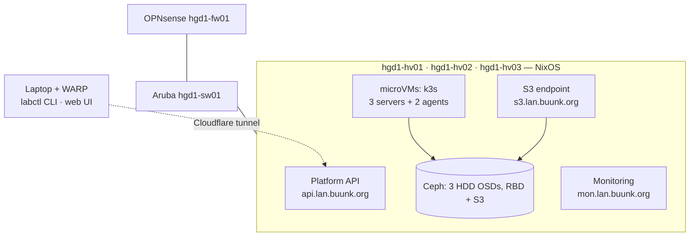

<div align="center">

# nix-hgd1-cluster

**My homelab at site `labctl`, fully declared in Nix:**
three small x86 nodes running NixOS, Ceph and a k3s cluster on microVMs,
with the OPNsense/Aruba network, remote access and monitoring around them.

[](https://jurrebuunk.github.io/nix-hgd1-cluster/)
[](https://github.com/jurrebuunk/nix-hgd1-cluster/actions/workflows/docs.yml)
[](https://github.com/jurrebuunk/nix-hgd1-cluster/commits/main)

[](https://nixos.org)
[](https://k3s.io)
[](https://ceph.io)
[](https://victoriametrics.com)
[](https://www.cloudflare.com/zero-trust/)
[](https://opnsense.org)

**[Documentation](https://jurrebuunk.github.io/nix-hgd1-cluster/)** ·
[Get started](https://jurrebuunk.github.io/nix-hgd1-cluster/get-started/) ·
[Concepts](https://jurrebuunk.github.io/nix-hgd1-cluster/concepts/) ·
[How-to](https://jurrebuunk.github.io/nix-hgd1-cluster/how-to/) ·
[Operate](https://jurrebuunk.github.io/nix-hgd1-cluster/operate/) ·
[Reference](https://jurrebuunk.github.io/nix-hgd1-cluster/reference/)

</div>

---

## What's inside



| Layer | What runs | Status |
| --- | --- | --- |
| Network | OPNsense + Aruba, five VLANs in `10.10.0.0/16`, internal DNS `lan.buunk.org` | ✅ |
| Remote access | Cloudflare Tunnel on every host, WARP on the laptop; no inbound ports | ✅ |
| Hosts | NixOS 26.05 on `hgd1-hv01..03`, deployed from this flake | ✅ |
| Storage | Ceph 20 with three replicas across hosts | ✅ |
| Object storage | `https://s3.lan.buunk.org`, highly available, Let's Encrypt via DNS-01 | ✅ |
| Kubernetes | k3s on microVMs, API VIP `k8s.lan.buunk.org`, zone labels per host | ✅ |
| Monitoring | VictoriaMetrics + VictoriaLogs on every host, router and switch included | ✅ |
| Platform API | `clusterd` at `api.lan.buunk.org` with the `labctl` CLI and a web UI on k3s | 🚧 |
| Cluster components | Flux, ingress, storage, Postgres on k3s: [`hgd1-k8s`](https://github.com/jurrebuunk/hgd1-k8s) | ↗️ |

Each layer survives the loss of any one host.

## Quick start

```sh
git clone https://github.com/jurrebuunk/nix-hgd1-cluster && cd nix-hgd1-cluster
nix develop                 # nixos-rebuild, agenix, kubectl, zensical, ...
warp-cli connect            # reach 10.10.0.0/16 from anywhere

nix flake check --no-build  # evaluate every host and VM, run inventory checks
deploy hgd1-hv01 switch     # deploy one host; then the next
kubeconfig                  # ~/.kube/hgd1.yaml for the k3s cluster
labctl status               # the platform at a glance, via the API
```

New here? Start with
[Get started](https://jurrebuunk.github.io/nix-hgd1-cluster/get-started/),
then read the
[Architecture](https://jurrebuunk.github.io/nix-hgd1-cluster/concepts/).

## Repository layout

| Path | What |
| --- | --- |
| [`inventory.nix`](inventory.nix) | **Source of truth**: addresses, disks, keys, VMs, k3s and monitoring settings |
| [`flake.nix`](flake.nix) | One `nixosConfiguration` per host and per VM, plus the dev shell |
| [`hosts/`](hosts/) | Shared host settings and per-host hardware |
| [`modules/`](modules/) | Network, Ceph, S3 endpoint, remote access, microVMs, k3s, monitoring, Platform API |
| [`lib/`](lib/) | Small pure helpers shared by modules |
| [`scripts/`](scripts/) | `deploy.sh`, `kubeconfig.sh`, `ceph-bootstrap.sh` |
| [`secrets/`](secrets/) | agenix-encrypted secrets (no plaintext ever) |
| [`docs/`](docs/) | The documentation site (Zensical) |

## Related repositories

| Repo | What |
| --- | --- |
| [`clusterd`](https://github.com/jurrebuunk/clusterd) | Platform API server and the `labctl` CLI (flake input here) |
| [`lab-console`](https://github.com/jurrebuunk/lab-console) | Web UI at `lab.buunk.org` |
| [`hgd1-k8s`](https://github.com/jurrebuunk/hgd1-k8s) | Base components of the k3s cluster (Flux) |
| `hgd1-network` (private) | Ansible for the OPNsense router and Aruba switch |

This handbook explains all of them; changes and development happen in each repo.

## Documentation

The full docs live at **<https://jurrebuunk.github.io/nix-hgd1-cluster/>**,
organised as Get started, Concepts, How-to guides, Operate and Reference.
They are built from [`docs/`](docs/) on every push to `main`.

```sh
nix develop
zensical serve      # live preview at http://localhost:8000
```

## Security notes

- Secrets are encrypted with [agenix](https://github.com/ryantm/agenix) to my
  laptop key and the hosts' SSH keys; see
  [Credentials](https://jurrebuunk.github.io/nix-hgd1-cluster/reference/credentials/)
  for where everything lives.
- The addresses in this repo are private (`10.10.0.0/16`). Nothing is exposed
  to the internet; remote access goes through Cloudflare Zero Trust.
