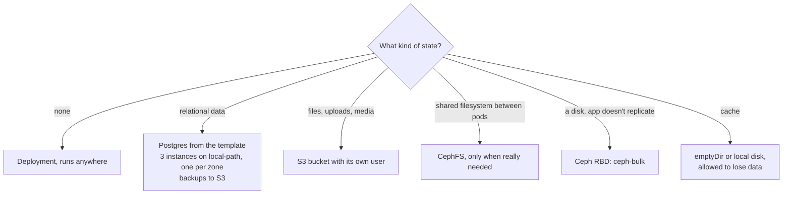

# Build on top

This page is for building something on the platform: a new app, a database,
a service that needs storage. You don't need to know NixOS for that. The
contract between this repo and your project is a **Kubernetes API**, the
**S3 endpoint** and the **Ceph cluster**.

## What the platform gives you

| You get | Details |
| --- | --- |
| Kubernetes API | `https://k8s.lan.buunk.org:6443`, k3s 1.35, five nodes (three schedulable servers, two agents) once finished |
| Zones | `topology.kubernetes.io/zone` = `hgd1-hv01`, `hgd1-hv02`, `hgd1-hv03`; one zone per physical host |
| Local disks | `local-path` StorageClass on each node's NVMe |
| Object storage | `https://s3.lan.buunk.org`, path-style, region `us-east-1` |
| Block storage | Ceph pool `k8s`; facts in ConfigMap `kube-system/hgd1-ceph` |
| Egress | Internet from pods (image registries, APIs) |
| Internal DNS | `*.lan.buunk.org` names resolve inside pods |

**Not there yet** (step 6, in the workloads repo): ingress, load balancers,
cert-manager, ceph-csi (so no `ceph-bulk` StorageClass yet) and the Postgres
operator. Until then, services only work inside the cluster.

## Getting access

```sh
git clone https://github.com/jurrebuunk/nix-hgd1-cluster
cd nix-hgd1-cluster
warp-cli connect
scripts/kubeconfig.sh            # ~/.kube/hgd1.yaml
export KUBECONFIG=~/.kube/hgd1.yaml
kubectl get nodes -L topology.kubernetes.io/zone
```

The workloads repo itself needs nothing from this flake, only that file.
Tools like Helm, Terraform, Flux or Argo CD can all use it.

## Where does your app's state go?

Ask this for every new app. The answer is almost always "Postgres", "S3" or
"nowhere".



The rules behind it:

1. Stateless apps can run anywhere.
2. Databases use a replicating operator (CloudNativePG): three instances on
   `local-path`, spread over zones, with continuous backups to S3. Use the
   shared template once it exists.
3. Files and user data go to S3 (or CephFS when you really need a shared
   filesystem), never `local-path`.
4. Apps that need a disk and don't replicate use Ceph RBD.
5. Caches may use local storage and may lose data.
6. **Never** put a single, non-replicated volume on `local-path`. When that
   node's host dies, the data is gone.

Why: the Ceph HDDs are reliable but slow (three laptop disks over 1 GbE), and
the NVMe is fast but local to one host. Databases get speed from NVMe and
safety from replicating themselves; everything else gets safety from Ceph.

## Spreading over hosts

Use the zone label so replicas don't end up on one physical machine:

```yaml
topologySpreadConstraints:
  - maxSkew: 1
    topologyKey: topology.kubernetes.io/zone
    whenUnsatisfiable: DoNotSchedule
    labelSelector:
      matchLabels:
        app: my-app
```

Two nodes share hv01 and two share hv03, so spreading by node name alone isn't
enough.

## Using S3 from a pod

Every node has a NIC on the storage VLAN, so pods reach
`https://s3.lan.buunk.org` directly with a valid certificate.

1. Create a user for your app (see [S3](../storage/s3.md#users-and-buckets)).
2. Put its keys in a Kubernetes Secret through your workloads repo's secret
   handling. Never put them in plain text in Git.
3. Configure the client: endpoint `https://s3.lan.buunk.org`, region
   `us-east-1`, path-style addressing.

If browsers must upload or download directly (presigned URLs), remember the
endpoint is only reachable on the storage VLAN. Exposing S3 to users is a
separate design decision.

## Ceph block storage (from step 6)

ceph-csi reads the cluster facts from the ConfigMap, so nothing has to be
copied by hand:

```sh
kubectl -n kube-system get configmap hgd1-ceph -o yaml
# data: fsid, monitors (10.10.30.11:6789,...), s3Endpoint
```

The VMs load the `rbd` and `ceph` kernel modules, and mapping an RBD image from
a VM has been tested against this Ceph version. ceph-csi needs a Ceph client
key restricted to the `k8s` pool; create it on a host and store it as a
Kubernetes Secret.

## Exposing an app (from step 6)

The plan: an ingress controller behind load balancer IPs on VLAN 40
(`10.10.40.200–249`). OPNsense already allows the users VLAN to reach those
IPs on 80 and 443. Certificates come from cert-manager with DNS-01, like the
S3 endpoint. Public exposure to the internet is not part of the design; that
would need its own security review (a DMZ or a Cloudflare tunnel for that
app).

## Checklist for a new app

- [ ] Where does its state go (the diagram above)?
- [ ] Deployment with at least two replicas if it must survive a host loss,
      with a zone spread constraint.
- [ ] Its own S3 user and bucket if it stores files.
- [ ] Postgres from the template if it needs a database.
- [ ] Secrets through the workloads repo's secret handling, never plain text.
- [ ] Requests and limits set: a node has 4 GiB of RAM in total.
- [ ] Tested: stop one VM with `scripts/k3s-roll.sh <vm>` and check the app
      keeps working.

## Changing the platform itself

If your project needs something from the platform (another VM, more memory,
a firewall rule, a new VLAN), that change happens in this repo. Read
[The repository](../understand/repository.md) and
[Change and deploy](../hosts/deploy.md) first.
