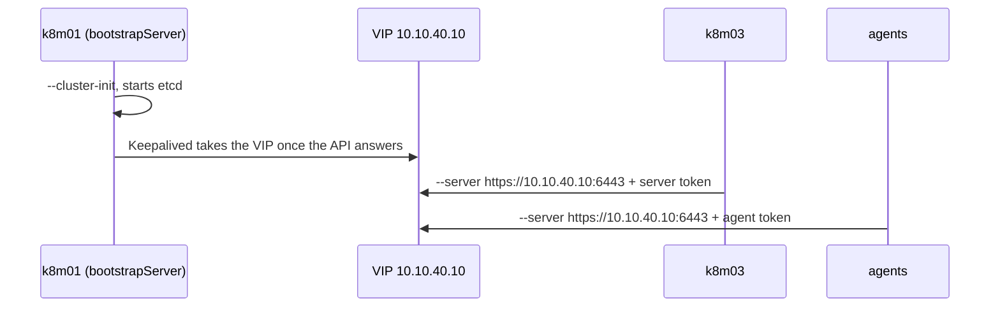

# k3s

The VMs form one Kubernetes cluster running [k3s](https://k3s.io/) 1.35:
three servers with embedded etcd, one per host, and two agents. This repo only
builds the cluster. What runs on it lives in a separate workloads repo (see
[Build on top](../build/index.md)).

!!! warning "Current state: 4 of 5 nodes"

    `hgd1-k8m02` waits until hv02 has VT-x enabled. Until it joins, etcd has
    **two** members and no fault tolerance: stopping either server stops the
    API. Don't restart `hgd1-k8m01` or `hgd1-k8m03` until the cluster is
    [finished](#finishing-the-cluster).

## Shape of the cluster

| Node | Host = zone | Role |
| --- | --- | --- |
| `hgd1-k8m01` | hgd1-hv01 | server (control plane + etcd); created the cluster |
| `hgd1-k8m02` | hgd1-hv02 | server (pending) |
| `hgd1-k8m03` | hgd1-hv03 | server |
| `hgd1-k8w01` | hgd1-hv01 | agent |
| `hgd1-k8w02` | hgd1-hv03 | agent |

- **API:** `https://k8s.lan.buunk.org:6443`, a floating IP (`10.10.40.10`)
  that Keepalived moves to a server whose API server answers.
- **Zones:** every node carries `topology.kubernetes.io/zone=<hypervisor>`,
  so workloads can spread over physical hosts.
- **Servers run workloads too** (no taint). hv02 only has a server, and a
  database spread over three zones needs a schedulable node in each.
- **Networking:** flannel VXLAN over the `k8s` NIC; pods in `10.42.0.0/16`,
  services in `10.43.0.0/16`.
- **Built-in add-ons:** CoreDNS, metrics-server and the `local-path`
  StorageClass. Traefik and ServiceLB are switched off; ingress and load
  balancers come from the workloads repo.

## Using the cluster

```sh
scripts/kubeconfig.sh        # writes ~/.kube/hgd1.yaml (mode 600), context "hgd1"
nix develop                  # kubectl, KUBECONFIG already points at it
kubectl get nodes -L topology.kubernetes.io/zone
```

The script copies the admin kubeconfig from a server VM (after checking its
SSH host key) and points it at `k8s.lan.buunk.org`. It needs WARP or the site
network; from the users VLAN without WARP the API is not reachable.

!!! danger "The kubeconfig is cluster-admin"

    It contains a client certificate with full rights. Never commit it, paste
    it or copy it to shared machines.

## How it is built

### Joining



`inventory.k3s.bootstrapServer` (`hgd1-k8m01`) gets `--cluster-init`; every
other node joins through the VIP. Once all three servers are members, the
bootstrap server is set to `null` so that a rebuilt `k8m01` rejoins instead of
starting a second, empty cluster.

### Tokens

There are two secrets, both agenix files encrypted to my laptop and the three
hosts: `k3s-server-token.age` and `k3s-agent-token.age`.

1. Each host decrypts them into plain files under `/run/k3s-secrets/<role>/`,
   only for the roles it actually runs (`modules/microvm/host/k3s-secrets.nix`).
2. That directory is shared read-only into the VM at `/run/k3s-secrets`.
3. Server VMs get both tokens; agents only get the agent token, so an agent
   can't join as a server.

Adding a VM needs no re-encryption, because the VM never decrypts anything
itself.

### State on a VM with a tmpfs root

| Path | Why it must persist | How |
| --- | --- | --- |
| `/var/lib/rancher/k3s` | etcd, containerd images, certificates | On the `/var/lib` disk |
| `/etc/rancher/node/password` | The servers reject a node whose password changed | Symlink to `/var/lib/rancher/node` |
| Pod logs | Would fill the RAM-backed root | Kubelet `podLogsDir = /var/lib/kubelet-pod-logs` |

### Firewall in the VMs

Only on the `k8s` NIC: kubelet 10250 and flannel 8472/udp everywhere; API
6443, etcd 2379–2380 and VRRP (only from the other servers) on servers. Pod
interfaces (`cni0`, `flannel.1`) are trusted, because Kubernetes polices that
traffic itself.

### Backups of etcd

Every server takes a local etcd snapshot every six hours and keeps 20, in
`/var/lib/rancher/k3s/server/db/snapshots`. They're not copied off the VM yet;
copying them to Ceph S3 is a later improvement.

### Where it is configured

| Piece | File |
| --- | --- |
| API name, VIP, VRRP id, bootstrap server | `inventory.nix` → `k3s` |
| Join URL and token paths | `lib/k3s.nix` |
| k3s flags, labels, kubelet config, persistence | `modules/microvm/guest/k3s/default.nix` |
| API VIP (Keepalived) | `modules/microvm/guest/k3s/api-vip.nix` |
| Ports | `modules/microvm/guest/k3s/firewall.nix` |
| `rbd`/`ceph` modules, `hgd1-ceph` ConfigMap | `modules/microvm/guest/k3s/ceph.nix` |

## Rolling restarts

A host deploy installs new VM versions but never restarts VMs. To boot them,
and for any planned VM restart, use:

```sh
scripts/k3s-roll.sh                 # all enabled VMs, agents first
scripts/k3s-roll.sh hgd1-k8w01      # just one
```

For each VM it:

1. Refuses to start unless every enabled VM is a Ready node, so a restart can
   never cost etcd quorum.
2. Drains the node (`--ignore-daemonsets --delete-emptydir-data`, 5 minutes).
3. Restarts the VM through `vm.sh`.
4. Waits up to 10 minutes for a **new boot** of that node to be Ready.
5. Uncordons it and checks the API.

Bare pods without a controller block the drain; that's intentional. If
something fails, the node stays cordoned. Fix it, then
`kubectl uncordon <node>`.

## Adding or moving a node

- **Add:** a new VM entry with `role = "server"` or `"agent"` (see
  [VMs](vms.md#adding-moving-and-removing-vms)). It joins on its own at first
  boot. Keep an odd number of servers.
- **Move:** `kubectl drain <node>`, `kubectl delete node <node>`, move the VM,
  and let it rejoin. Its zone label is only set when it registers, which is
  why the node object has to go.

## Finishing the cluster

What's left of step 4, once I'm at hv02:

1. On a host: `sudo ceph osd set noout`. Shut hv02 down, enable Intel
   virtualization (VT-x) in its BIOS and boot it. Check that `/dev/kvm`
   exists, then `sudo ceph osd unset noout` and wait for `HEALTH_OK`.
2. Set `hosts.hgd1-hv02.kvmAvailable = true` and
   `vms.hgd1-k8m02.enabled = true`. Commit, then
   `scripts/deploy.sh hgd1-hv02 switch` and pin k8m02's `hostKey`.
3. Check that `kubectl get nodes` shows three `control-plane,etcd` nodes.
4. Set `k3s.bootstrapServer = null`, commit, deploy hv01, and run
   `scripts/k3s-roll.sh hgd1-k8m01` while `kubectl get nodes` runs in a loop
   in another terminal. The API must stay reachable through the VIP the
   whole time.

When that passes, the cluster survives losing any one host.
