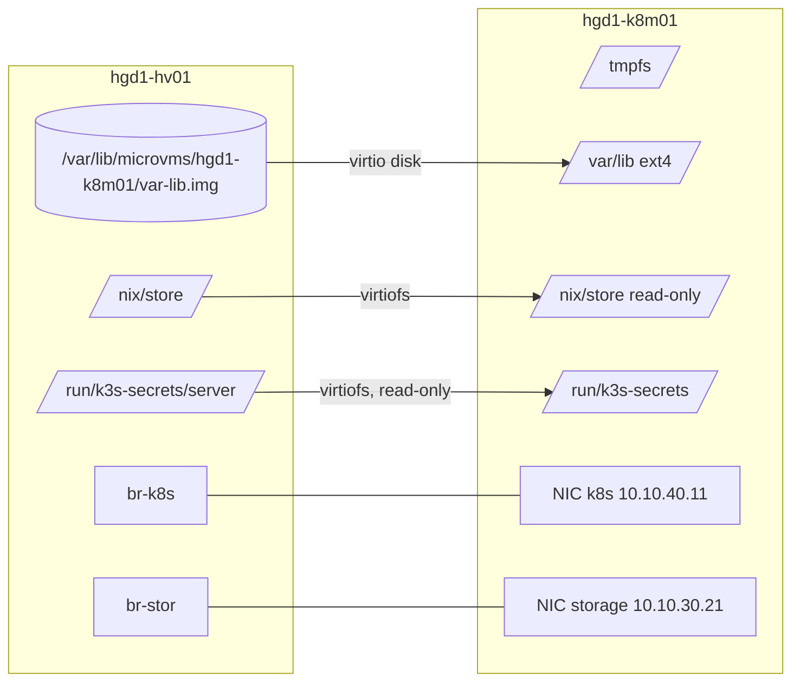

# Virtual machines

The k3s nodes are small QEMU VMs managed by
[microvm.nix](https://github.com/microvm-nix/microvm.nix). Each VM is a NixOS
configuration in this flake and runs on its host as the systemd service
`microvm@<name>`. VMs only exist because the inventory says so; nothing is
ever created by hand.

## The VMs

| VM | Host | Role | k8s IP | Storage IP | vCPU / RAM / disk |
| --- | --- | --- | --- | --- | --- |
| `hgd1-k8m01` | hv01 | server | `10.10.40.11` | `10.10.30.21` | 2 / 4 GiB / 60 GiB |
| `hgd1-k8m02` | hv02 | server | `10.10.40.12` | `10.10.30.22` | 2 / 4 GiB / 60 GiB, **disabled until hv02 has VT-x** |
| `hgd1-k8m03` | hv03 | server | `10.10.40.13` | `10.10.30.23` | 2 / 4 GiB / 60 GiB |
| `hgd1-k8w01` | hv01 | agent | `10.10.40.21` | `10.10.30.31` | 4 / 4 GiB / 60 GiB |
| `hgd1-k8w02` | hv03 | agent | `10.10.40.22` | `10.10.30.32` | 4 / 4 GiB / 60 GiB |

```sh
scripts/vm.sh list          # name, host, enabled, k8s IP, storage IP
```

## Anatomy of a VM



- **Root is a tmpfs.** Everything outside `/var/lib` is rebuilt from Nix on
  every boot. The OS is disposable; only `/var/lib` survives.
- **`/var/lib` is one ext4 disk image** on the host's NVMe,
  `/var/lib/microvms/<name>/var-lib.img`. It's sparse, so the 60 GiB is a
  maximum, not what it uses. It holds k3s, etcd, containerd, pod logs and the
  VM's SSH host key.
- **The Nix store is shared read-only** from the host over virtiofs; the host
  builds the VM's system as part of its own.
- **Two NICs** on TAP devices: `k8s` (bridged to `br-k8s`, default route,
  DNS and NTP via `10.10.40.1`) and `storage` (bridged to `br-stor`, no
  gateway). NIC names are matched by MAC, so they can't swap.
- **MACs and TAP names derive from the VM's `id`** (`lib/vm-network.nix`):
  `id = 11` gives `tap11-k8s` and `02:00:00:40:00:0b`. Never change an id.

## Logging in

```sh
ssh jurre@10.10.40.11
```

Key-only, `jurre` with passwordless sudo, only on the `k8s` NIC. Each VM's
public SSH host key is pinned in the inventory (`hostKey`).

A new VM generates its key on first boot and prints the **public** part on its
serial console. Read it from the trusted host's journal instead of trusting
whatever answers on the network:

```sh
ssh jurre@10.10.20.11 'sudo journalctl -u microvm@hgd1-k8w01 -o cat | grep VM_HOST_KEY'
```

Copy that key into the VM's `hostKey` in `inventory.nix` and commit.

## Lifecycle

```sh
scripts/vm.sh hgd1-k8m01 status
scripts/vm.sh hgd1-k8m01 logs
scripts/vm.sh hgd1-k8m01 restart       # also: start, stop
```

`vm.sh` checks the hypervisor's host key against the inventory, then runs
`systemctl` on the unit. It never creates, moves or deletes disks.

!!! warning "vm.sh doesn't know about Kubernetes"

    It restarts a VM without draining it or checking etcd quorum. For k3s
    nodes, use [`scripts/k3s-roll.sh`](k3s.md#rolling-restarts) instead.

## How updates reach a VM

1. Change a guest module or the inventory, commit, and deploy the owning host.
2. The host installs the new runner (`/var/lib/microvms/<name>/current`) but
   **doesn't restart the VM**: `restartIfChanged = false`, so a host deploy
   never takes down all its VMs at once.
3. Restart the VM deliberately (`k3s-roll.sh`). Until then it runs the
   version it booted (`booted` points to it).

A VM whose host reboots starts again automatically.

## Adding, moving and removing VMs

**Add.**

1. Add an entry under `vms` in `inventory.nix` with a new unique `id`, two
   free IPs and `enabled = true`.
2. `nix flake check --no-build` checks for collisions and memory limits.
3. Commit, deploy the owning host, and pin the `hostKey` from the journal.
4. Add a DNS override on OPNsense if you want a name.

**Move** (k3s nodes: drain and delete the node first, see [k3s](k3s.md)):

1. Stop the VM and confirm it's stopped.
2. Change `host`, deploy the **old** host first (removes the runner), then the
   new one.
3. The disk image doesn't move by itself. Copy it while the VM is stopped, or
   start fresh and let the VM rejoin. Never run two copies of one disk image.
4. Delete the old directory on the old host once the VM works on the new one.

**Remove.** Set `enabled = false` (or delete the entry) and deploy the host.
The disk image stays in `/var/lib/microvms/<name>/` until you delete it.

!!! note "Disk size"

    `diskGB` only applies when the image is first created. Changing it later
    doesn't resize the image. Never shrink an existing filesystem.

## Isolation

- The host has no address on `br-k8s`, and its firewall drops any input from
  `br-k8s` and any routing between the bridges and the rest of the host. A VM
  cannot use its host to get around OPNsense.
- SSH on the host only listens on the management NIC; tests confirmed a VM
  can't reach it through either bridge.
- QEMU's bridge helper is disabled (`deny all`); only declared TAPs are used.

## Where it is configured

| File | Owns |
| --- | --- |
| `inventory.nix` → `vms` | Placement, role, resources, id, IPs, host key |
| `lib/vm-network.nix` | MACs and TAP names from the id |
| `modules/microvm/host/default.nix` | Which VMs run here, autostart, no restart on change |
| `modules/microvm/host/validation.nix` | Inventory checks: unique ids and IPs, VLANs, memory, KVM |
| `modules/microvm/host/networking.nix` | TAPs on bridges, isolation firewall |
| `modules/microvm/host/k3s-secrets.nix` | k3s tokens shared into the VMs |
| `modules/microvm/guest/default.nix` | QEMU resources, shares and the `/var/lib` volume |
| `modules/microvm/guest/networking.nix` | NIC names, addresses, routes, DNS |
| `modules/microvm/guest/access.nix` | Users, SSH and the host key report |
