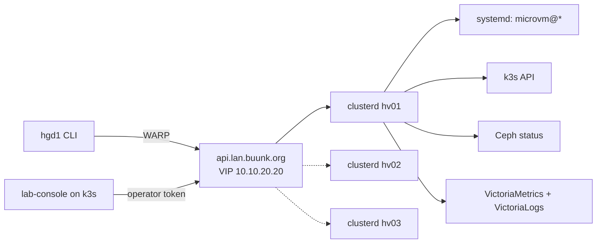

# Platform API

`clusterd` is a small REST API that runs on all three hypervisors behind one
highly available address, **`https://api.lan.buunk.org`**. It is the single,
authenticated entry point for managing and developing on the platform: the
[CLI](../how-to/use-the-cli.md) and the [web UI](web-ui.md) talk to it, never
to the hosts, Ceph or the monitoring stores directly.

!!! info "At a glance"

    **Status** <span class="status status--partial">In development</span> ·
    **Repo** [`clusterd`](https://github.com/jurrebuunk/clusterd) (server + CLI) ·
    **Endpoint** `https://api.lan.buunk.org` (VIP `10.10.20.20`, infra VLAN) ·
    **Configured in** `modules/clusterd/`, `inventory.nix` → `api` ·
    **Reference** [API reference](../reference/api.md)

## Overview



- **Same pattern as S3, the k3s API and monitoring:** a Keepalived VIP moves
  to a host whose `clusterd` answers its health check. A host can die and the
  API stays up.
- **Stateless.** Every instance reads live state from systemd, the k3s API,
  Ceph and the monitoring stores. There is nothing to replicate or back up.
- **Infra VLAN only.** From outside the site that means WARP, so managing the
  platform is only possible with WARP connected.
- **Nix decides what exists.** The API reads the VM list from the inventory and
  performs actions on what's there (restart, drain, maintenance). It never
  creates or deletes VMs.

## How it works

### Access and auth

Two layers, both required:

1. **Network.** `api.lan.buunk.org` lives on the infra VLAN. The internet and
   the users VLAN can't reach it. The management VLAN and remote access through
   Cloudflare (my email only, see [Remote access](remote-access.md)) can, and
   one OPNsense rule (in [`hgd1-network`](https://github.com/jurrebuunk/hgd1-network)) lets the web UI's pod on k3s reach port 443.
2. **Tokens.** Every request carries a bearer token. Tokens have a scope:

    | Scope | For | Allows |
    | --- | --- | --- |
    | `read` | Dashboards, scripts | Status, metrics and logs |
    | `operator` | The [web UI](web-ui.md)'s proxy | `read` plus a few safe actions |
    | `manage` | The CLI over WARP | Everything |

    Token hashes live in the agenix secret `secrets/api-tokens.age`; the plain
    token only ever exists on the client. Later, Keycloak (OIDC) replaces
    hand-made tokens.

### Metrics and logs proxy

The web UI and the CLI need metrics and logs, but the monitoring stores have no
auth and must stay read-only. `clusterd` exposes only the **query** endpoints
of VictoriaMetrics and VictoriaLogs under `/v1/metrics/` and `/v1/logs/`,
behind the token check. Write, delete and admin endpoints are never proxied.
Each instance queries its local store first (every host holds a full copy) and
falls back to a peer.

### Actions

Actions are added one by one as they're needed. Each one wraps an existing,
safe procedure: for example a VM restart runs the same drain → restart →
Ready → uncordon sequence as `scripts/k3s-roll.sh`. Every `manage` request is
written to the journal of `clusterd.service`, so it ends up in VictoriaLogs as
an audit trail.

### Privileges

| Needs | How it's limited |
| --- | --- |
| Restart VMs | A polkit rule lets the `clusterd` user manage only `microvm@*.service` |
| Kubernetes (drain, uncordon, node status) | Its own ServiceAccount with a narrow role; kubeconfig in `secrets/clusterd-kubeconfig.age` |
| Ceph status | A read-only client key (`client.clusterd`, `mon 'allow r'`), host-only |
| Metrics and logs | Plain HTTP to the local stores on `127.0.0.1` |

### TLS

Like the S3 endpoint, every host gets a Let's Encrypt certificate for
`api.lan.buunk.org` through DNS-01, so clients verify a real certificate with
no exceptions.

## Configuration

The server, the CLI and the NixOS module (`services.clusterd`, including the
polkit rule) come from the [`clusterd`](https://github.com/jurrebuunk/clusterd)
repo as a flake input. This repo only configures them:

| File | Owns |
| --- | --- |
| `flake.nix` → `inputs.clusterd` | The `clusterd` version in use (`nix flake update clusterd`) |
| `inventory.nix` → `api` | Hostname, VIP, VRRP id |
| `modules/clusterd/default.nix` | Enables `services.clusterd` with settings from the inventory |
| `modules/clusterd/tls.nix` | ACME certificate through DNS-01 |
| `modules/clusterd/vip.nix` | Keepalived and the health check |
| `modules/clusterd/firewall.nix` | HTTPS on the management NIC, VRRP from peers |
| `secrets/api-tokens.age`, `secrets/clusterd-kubeconfig.age` | Token hashes, Kubernetes access |

## Operating

```sh
hgd1 status                                   # through the API
curl -s https://api.lan.buunk.org/v1/health   # no token needed
for h in 11 12 13; do ssh jurre@10.10.20.$h 'systemctl is-active clusterd'; done
```

- New token: see [Use the CLI → Tokens](../how-to/use-the-cli.md#tokens).
- Audit trail: `hgd1 logs --unit clusterd.service --since 1d`.

## Develop

Code, tests, the API definition and releases of `clusterd` and the `hgd1` CLI
live in [`clusterd`](https://github.com/jurrebuunk/clusterd). Adding an
endpoint or action happens there; this repo then picks up the new version with
`nix flake update clusterd` and a normal deploy. Point the CLI at a single
host while developing with `HGD1_API`.

## Troubleshooting

See [Troubleshooting → API](../operate/troubleshooting.md#api).

## Related

- [API reference](../reference/api.md) · [Use the CLI](../how-to/use-the-cli.md) ·
  [Web UI](web-ui.md) · [Monitoring](monitoring.md)
