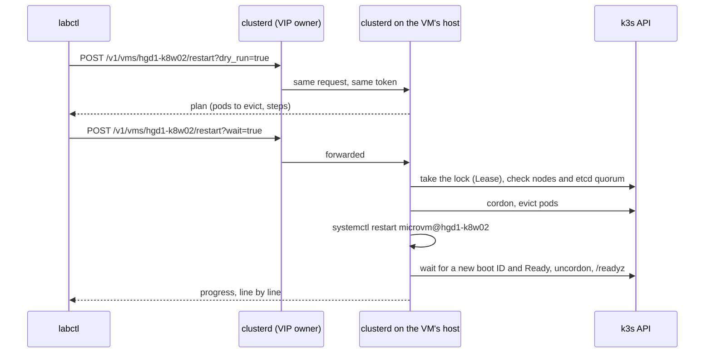

# Platform API

!!! repo "Lives in its own repo: clusterd"

    This page covers **the Platform API (`clusterd`)** on the hgd1 cluster: how it fits in and how I
    use it here. Code, development, releases and the full documentation are in
    the repo.

    [:fontawesome-brands-github: jurrebuunk/clusterd](https://github.com/jurrebuunk/clusterd){ .md-button .md-button--primary }

`clusterd` is a small REST API that runs on all three hypervisors behind one
highly available address, **`https://api.lan.buunk.org`**. It is the single,
authenticated entry point for managing and developing on the platform: the
[CLI](../how-to/use-the-cli.md) and the [web UI](web-ui.md) talk to it, never
to the hosts, Ceph or the monitoring stores directly.

!!! info "At a glance"

    **Status** <span class="status">v1.2.1</span> ·
    **Endpoint** `https://api.lan.buunk.org` (VIP `10.10.20.20`, infra VLAN) ·
    **Configured in** `modules/clusterd/`, `inventory.nix` → `api` ·
    **Reference** [API reference](../reference/api.md)

## Overview


- **Same pattern as S3, the k3s API and monitoring:** a Keepalived VIP moves
  to a host whose `clusterd` answers its health check. A host can die and the
  API stays up.
- **Stateless.** Every instance reads live state from systemd, the k3s API,
  Ceph and the monitoring stores. There is nothing to replicate or back up.
- **Infra VLAN only.** From outside the site that means WARP, so managing the
  platform is only possible with WARP connected.
- **Nix decides what exists.** The API reads the VM list from the inventory and
  performs actions on what's there (restart, drain, maintenance). It never
  creates or deletes VMs.

`v1.2.1` runs now: the site as resources (hosts, VMs, nodes, pods, Ceph,
disks, VIPs, S3 buckets and users), one health verdict (`/v1/checks`),
metrics, logs, the history of every action, and actions: VM restart, stop
and start, node cordon and uncordon, host maintenance and resume, and S3
users and buckets. `/v1` is stable from `2.0.0` on: only backward-compatible
changes; anything breaking would go to `/v2` (see the
[clusterd plan](https://github.com/jurrebuunk/clusterd/blob/main/PLAN.md)).

## How it works

### Access and auth

Two layers, both required:

1. **Network.** `api.lan.buunk.org` lives on the infra VLAN. The internet and
   the users VLAN can't reach it. The management VLAN and remote access through
   Cloudflare (my email only, see [Remote access](remote-access.md)) can, and
   one OPNsense rule (in [`hgd1-network`](https://github.com/jurrebuunk/hgd1-network)) lets the web UI's pod on k3s reach port 443.
2. **Tokens.** Every request carries a bearer token. Tokens have a scope:

    | Scope | For | Allows |
    | --- | --- | --- |
    | `read` | Dashboards, scripts | Status, metrics and logs |
    | `operator` | The [web UI](web-ui.md)'s proxy | `read` plus a few safe actions |
    | `manage` | The CLI over WARP | Everything |

    Token hashes live in the agenix secret `secrets/api-tokens.age`; the plain
    token only ever exists on the client. Later, Keycloak (OIDC) replaces
    hand-made tokens.

### Health and status

- **`/v1/health`** answers as long as the instance serves requests. It
  deliberately ignores the monitoring stores: the proxy falls back to peers,
  so a broken local store must not pull the API down with it. Keepalived
  calls it every two seconds with full certificate validation.
- **`/v1/status`** is put together by the instance that answers. Ceph health
  comes from a copy refreshed every 10 seconds (the `ceph` CLI takes half a
  second; asking it per request made `status` slow); `as_of` and the AGE
  column say how old it is. It reads k3s
  and Ceph itself and asks every peer's `/v1/internal/node` (that host's
  uptime, load, memory, VMs, VIPs and NixOS system) **with the caller's own
  token**. The instances share
  no credential of their own, and a peer only tells a caller what it would
  tell them directly. An unreachable peer shows up as `unreachable`; its VMs
  and any VIP it may hold as `unknown`.

- **Resources, like real APIs.** Every part is its own collection
  (`/v1/hosts`, `/v1/vms`, `/v1/nodes`, `/v1/pods`, `/v1/disks`,
  `/v1/s3/buckets`, …) with `/{name}` for one item, and actions are a `POST`
  on the item (`/v1/vms/{name}/stop`), as in GitHub's or Proxmox's API. A
  script or the web UI only asks for what it shows.
- **What each host runs.** The cluster sets `system.configurationRevision`
  to the git commit, so `labctl host list` shows which commit each host
  runs and whether a new kernel waits for a reboot; `labctl health` warns
  when the hosts differ.

### Disks and S3

| Part | What it shows | Where it comes from |
| --- | --- | --- |
| `disks` | Every physical drive: size, **how full** (its OSD's usage, or the filesystems on its partitions), role (`system`, `osd.N`), NVMe wear, temperature, SMART. Filesystems of hosts and VMs (df-style), OSDs | SMART and node metrics (about 30 s old), `ceph osd df` and `ceph osd metadata` (cached 60 s) |
| `s3` | Gateways up, users, buckets with objects, size, quota and how full, the data pool's room, the certificate's expiry | The RGW admin API (live) with a read-only RGW user `clusterd`; HAProxy, Ceph pool and probe metrics |

`labctl` warns on stderr about NVMe wear of 80% or more, failing SMART,
filesystems over 85%, buckets over 90% of their quota and a certificate that
expires within two weeks.

### Metrics and logs proxy

The web UI and the CLI need metrics and logs, but the monitoring stores have no
auth and must stay read-only. `clusterd` exposes only the **query** endpoints
of VictoriaMetrics and VictoriaLogs under `/v1/metrics/` and `/v1/logs/`,
behind the token check. Write, delete and admin endpoints are never proxied.
Each instance queries its local store first (every host holds a full copy) and
falls back to a peer on connection errors and 5xx answers. Limits: 30 s per
query, 64 MiB per answer, at most 1 h of `--follow`, and 1000 log lines when
the caller gives no `limit`. The caller's token is never passed on.

### Actions

Actions are added one by one as they're needed; each wraps a safe
procedure that used to be a script or SSH session:

| Action | Scope | Replaces |
| --- | --- | --- |
| VM restart, stop, start (`labctl vm …`, `vm roll`) | operator | `scripts/vm.sh`, `scripts/k3s-roll.sh` |
| Node cordon, uncordon | operator | `kubectl cordon/uncordon` |
| Host maintenance and resume | manage | drains, `ceph osd set noout`, reboot and uncordon by hand |
| S3 users (create, rotate keys, delete) and buckets (create, quota, delete) | manage | `radosgw-admin` over SSH |

The VM restart shows how they work:



- **Runs where the VM lives.** Only that host can restart its VM, so the
  instance that receives the request passes it on with the caller's token.
- **Checks first.** The VM must be enabled in the inventory; every *other*
  node must be Ready (the target itself may be broken, that's often why you
  restart it); etcd must keep quorum; and no pod without a controller may be
  on the node, because it would be lost. A failed check is a `412` with the
  reason; nothing has changed then.
- **One at a time.** A Kubernetes Lease (`clusterd/clusterd-disruption`)
  makes every disruptive action exclusive across the cluster. A second request
  gets `409` with who holds it. The lease is renewed while the action runs and
  expires two minutes after a crash.
- **Safe when it fails.** A failed drain uncordons the node again; a VM that
  doesn't come back stays cordoned, so nothing gets scheduled on it.
- **Finishes on its own.** Every action is an operation with an ID. `labctl`
  follows its progress as JSON lines, but the action doesn't depend on the
  client: if WARP drops, it completes, and `labctl operation show <id>`
  has the result.
- **History without new state.** Start, progress and end of every action
  (and every S3 write) are `msg=audit` and `action progress` lines in the
  journal of `clusterd.service` (action, target, token, scope, request ID,
  result), and so in VictoriaLogs. `/v1/operations` is a query over those:
  `labctl operation list` shows who did what, when, and how it ended.

### Privileges

| Needs | How it's limited |
| --- | --- |
| Run as | System user `clusterd`; only `CAP_NET_BIND_SERVICE`, read-only file system, no new privileges |
| VM state | `systemctl list-units`, read-only and unprivileged |
| Restart, stop, start VMs | A polkit rule (from `services.clusterd.manageUnitPrefixes`) lets the `clusterd` user `restart`, `start` and `stop` only `microvm@*.service`; nothing else |
| Reboot its own host | Only for host maintenance with `--reboot` (scope `manage`): a polkit rule (`services.clusterd.allowReboot`) allows the `clusterd` user logind's reboot actions, not power-off |
| Kubernetes | ServiceAccount `clusterd/clusterd`: read nodes and pods, patch nodes (cordon), create evictions, and manage Leases in its own namespace only. Declared in `modules/microvm/guest/k3s/clusterd.nix`; kubeconfig in `secrets/clusterd-kubeconfig.age` |
| Ceph status, OSD usage, maintenance flag | Client key `client.clusterd`: `mon 'allow r'` plus only the commands `osd set-group` and `osd unset-group` (per-host `noout`), and `mgr 'allow r'` (for `osd df`); in `secrets/clusterd-ceph-keyring.age` |
| S3 buckets and users | RGW user `clusterd`: caps `buckets=*` and `users=*` (create and delete users, keys, bucket quotas), `usage` and `metadata` `read`, no buckets of its own; keys in `secrets/clusterd-s3-admin.age`. Buckets are created with their owner's key, so they belong to the owner. It talks to each host's RGW on the storage VLAN (`:7480`) |
| Metrics and logs | Plain HTTP to the local stores on `127.0.0.1`, peers on the infra VLAN |

Secrets reach the service as systemd credentials (`/run/credentials/clusterd.service/`),
never through the Nix store or the environment.

### TLS

Like the S3 endpoint, every host gets a Let's Encrypt certificate for
`api.lan.buunk.org` through DNS-01, so clients verify a real certificate with
no exceptions. Peers check each other against the same name. After a renewal,
ACME runs `systemctl reload clusterd`, which swaps the certificate without
dropping connections.

## Configuration

The server, the CLI and the NixOS module (`services.clusterd`, including the
polkit rule) come from the [`clusterd`](https://github.com/jurrebuunk/clusterd)
repo as a flake input. This repo only configures them:

| File | Owns |
| --- | --- |
| `flake.nix` → `inputs.clusterd` | The `clusterd` release in use, pinned to its tag (now `github:jurrebuunk/clusterd/v1.2.1`) |
| `inventory.nix` → `api` | Hostname, VIP, VRRP id |
| `modules/clusterd/default.nix` | Enables `services.clusterd` with settings from the inventory |
| `modules/clusterd/tls.nix` | ACME certificate through DNS-01 |
| `modules/clusterd/vip.nix` | Keepalived and the health check |
| `modules/clusterd/firewall.nix` | HTTPS on the management NIC (VRRP from the peers is already open) |
| `modules/microvm/guest/k3s/clusterd.nix` | The ServiceAccount and its role, as a k3s manifest |
| `secrets/api-tokens.age`, `secrets/clusterd-kubeconfig.age`, `secrets/clusterd-ceph-keyring.age`, `secrets/clusterd-s3-admin.age` | Token hashes, Kubernetes access, Ceph access, RGW admin read access |

## Operating

```sh
labctl host list                              # every instance and its version (CLUSTERD)
labctl vip list                               # who holds api
curl -s https://api.lan.buunk.org/v1/health   # no token needed
```

- New token: see [Use the CLI → Tokens](../how-to/use-the-cli.md#tokens).
- Access log: `labctl logs --unit clusterd --since 1d` (every request
  except successful health checks, with token name and request ID; never
  query strings). Only the audit records: `labctl logs --unit clusterd --since 1w audit`.
- Who holds the action lock: `kubectl -n clusterd get lease clusterd-disruption -o yaml`.
- Its own metrics: `labctl metrics query 'sum by (route, code) (rate(clusterd_requests_total[5m]))'`.
- Changed secrets restart `clusterd` on the next deploy (systemd credentials
  are copied in at start); a renewed certificate only needs a reload.

## Develop

Code, tests, the API definition and releases of `clusterd` and the `labctl` CLI
live in [`clusterd`](https://github.com/jurrebuunk/clusterd). Adding an
endpoint or action happens there; this repo then picks up the new version with
a new tag in `inputs.clusterd.url`, `nix flake update clusterd` and a normal
deploy. The hosts always run a tagged release from
[GitHub Releases](https://github.com/jurrebuunk/clusterd/releases), never `main`. Point the CLI at a single
host while developing with `LABCTL_API`.

## Troubleshooting

See [Troubleshooting → API](../operate/troubleshooting.md#api).

## Tested

`v1.1.0`:

- `labctl health` exits 0 on the healthy site; with `hgd1-k8w02` stopped it
  showed `vms` and `nodes` as `fail` and exited 5.
- `labctl vm stop hgd1-k8w02` drained and stopped it; `vm start` brought it
  back Ready and uncordoned. Starting a running VM is refused.
- `labctl vm roll` restarted all five VMs, agents first, in 190 s; the API
  answered all 163 requests during it.
- `labctl node cordon` / `uncordon`, and `labctl logs --unit 'ceph-osd*'`.
- `labctl host maintenance hgd1-hv03 --dry-run --reboot` passes its checks
  and plans the steps. A real maintenance with reboot hasn't run yet.

`v1.0.0`:

- Every `/v1/status/<part>` answers in 0.10–0.15 s; the full status in about
  0.2 s.
- Disks: all six drives with size, use, wear, temperature and SMART; the
  system disks count `/` and `/boot` but not the `/nix/store` bind mount
  twice; each HDD maps to its OSD.
- S3: a temporary bucket with one 5 MB object and a 1 GiB quota showed up
  with the right owner, size, objects and fullness, and was removed again.
- A VM restart on the released build.

`v1.0.0-rc.1`, from GitHub Releases on all three hosts:

- A rolling restart of all five VMs with `labctl vm restart` (agents, then
  the three servers), 29–44 s each. The API answered all 161 status requests
  during it; the Kubernetes API probes never failed.
- The first restart came in through hv02 and ran on hv03 (forwarded), with
  an `operator` token. A `read` token gets 403, an unknown VM 404.
- While one restart ran, a second one of the same VM and one of another VM
  both got 409 naming the holder.
- `labctl status` dropped from about 0.7 s to under 0.2 s with the Ceph cache.

`v0.1.0`:

- The release's checksum and build provenance verify.
- No token and an unknown token give 401; a `read` token on `/v1/actions/…`
  gives 403. Write and admin paths of both stores give 404, also with `..`
  in the path.
- `labctl status` over WARP: three hosts, five VMs, five Ready nodes, Ceph,
  VIP owners. Metrics, log search, LogsQL pipes and `logs --follow` work.
- Stopping `clusterd` on the VIP owner moved the VIP to the next host. A
  client asking five times per second saw 8 of 116 requests fail (about two
  seconds); `labctl status` kept working and showed the stopped host as
  unreachable.
- The renewed certificate was picked up by a reload, with no restart.

## Related

- [API reference](../reference/api.md) · [Use the CLI](../how-to/use-the-cli.md) ·
  [Web UI](web-ui.md) · [Monitoring](monitoring.md)
