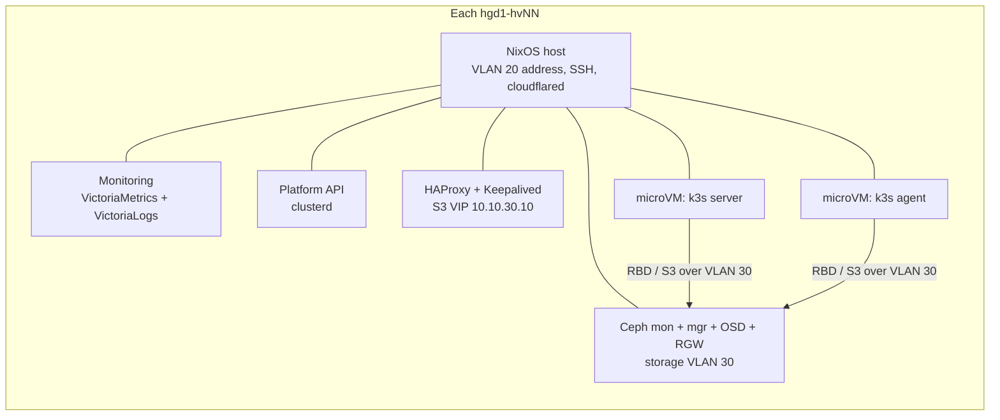

# Architecture

How the pieces fit together and why I chose them. Read this once before
changing anything; the other concept pages assume you know it.

## Goals

- **All configuration lives in Nix.** Hosts, storage, VMs and the Kubernetes
  node OS come from one flake. The router and switch are the exception: they
  are configured over SSH and documented here instead.
- **VMs are disposable.** Adding, moving or rebuilding a k3s node is a small
  inventory change plus a deploy.
- **Ceph on the hosts provides storage** for everything that runs on k3s.
- **One host may fail at any time** without losing data or the services built
  on top.
- **One API to manage it all:** the [Platform API](api.md) on every host, used
  by the `labctl` CLI and the web UI, with auth and an audit trail.

## Hardware

Three identical small-form-factor office PCs. They used to run Proxmox as
`pve0..2`; now they run NixOS as `hgd1-hv01..03`.

| Per node | |
| --- | --- |
| CPU | Intel i5-6500T, 4 cores |
| RAM | 16 GiB |
| NVMe | 256 GB: EFI and an ext4 root with the OS, the Nix store and VM disks |
| HDD | 1 TB HGST 2.5" laptop disk, used entirely by Ceph |
| NIC | One 1 GbE port, `enp2s0`, carrying all VLANs |

The network around them:

- **Router:** OPNsense (`hgd1-fw01`) with an onboard NIC for WAN and a 4-port
  PCIe card for the internal trunk.
- **Switch:** HP/Aruba 2530-48G (`hgd1-sw01`).
- **GPU server:** `hgd1-gpu1` with a Windows gaming VM. It has its own repo
  ([`nix-hgd1-gpu1`](https://github.com/jurrebuunk/nix-hgd1-gpu1)) and is not
  part of this cluster; it only shares the network.

The internet comes from my home router (`192.168.2.0/24`). OPNsense treats
that whole home network as WAN, so nothing from home reaches the site unless
a rule allows it.

## Layers

1. **Network.** Every host has one cable. The untagged VLAN 20 carries host
   management; VLAN 30 (storage) and VLAN 40 (k8s) arrive tagged and end in
   two bridges, `br-stor` and `br-k8s`. See [Network](network.md).
2. **NixOS host.** The same configuration on all three, with per-host facts
   from the inventory. Deployed from the laptop; the host builds its own
   system. See [Hosts](hosts.md).
3. **Ceph.** One monitor, one manager, one OSD and one S3 gateway (RGW) per
   host. Three copies of every object, one per host. See
   [Ceph](ceph.md).
4. **S3 endpoint.** A floating IP on the storage VLAN with HTTPS in front of
   the three gateways, independent of Kubernetes. See [S3](s3.md).
5. **microVMs.** Small QEMU VMs defined in Nix and run as systemd services on
   the hosts. Their disks live on the host NVMe. See [VMs](vms.md).
6. **k3s.** Three servers (one per host, embedded etcd) and two agents. See
   [k3s](k3s.md).
7. **Monitoring.** Metrics and logs for everything above, stored on every
   host and queried through `mon.lan.buunk.org`. See [Monitoring](monitoring.md).
8. **Platform API.** `clusterd` on every host behind `api.lan.buunk.org`:
   status, metrics, logs and actions with token auth, for the `labctl` CLI and
   the web UI. See [Platform API](api.md).
9. **Workloads.** Everything that runs on Kubernetes lives in a separate
   repo that only needs a kubeconfig. See [Build on top](../how-to/build-an-app.md).

## Decisions

??? note "microvm.nix instead of Proxmox or libvirt"

    VMs are NixOS configurations in the same flake as the hosts and run as
    plain systemd units (`microvm@<name>`). There is no live migration; that
    is fine, because Kubernetes provides availability across hosts, not the
    hypervisor. Creating a VM is a Nix change, never a click.

??? note "Ceph on the hosts, HDDs only"

    Ceph runs directly on the hypervisors, not in VMs or in Kubernetes. That
    way storage does not depend on the cluster that uses it. Only the HDDs
    go into Ceph; the NVMe stays for the OS and VM disks. Three 1 TB HDDs with
    three replicas give roughly 800 GB usable before Ceph warns about filling
    up.

??? note "Databases on local NVMe, replicating themselves"

    Three laptop HDDs over 1 GbE are fine for files, logs and backups, and too
    slow for busy databases. Databases therefore run on local NVMe through
    `local-path` and replicate at the application level (CloudNativePG,
    three instances, one per host), with backups to Ceph S3.

??? note "Static addresses everywhere"

    Ceph monitor addresses must never change, and I want to be able to read
    an address and know what it is. Hosts and VMs have static IPs from
    the inventory; only the management and user VLANs have DHCP.

??? note "Remote access through Cloudflare, not port forwards"

    The site has no inbound ports from the internet. `cloudflared` on all
    three hosts connects out to Cloudflare, and my laptop reaches
    `10.10.0.0/16` through the WARP client. Any one host keeps access up.

??? note "A floating IP for every 'one address' service"

    Both the S3 endpoint and the Kubernetes API use Keepalived (VRRP) to move
    one IP to a healthy node. It is simple, has no extra moving parts and
    behaves the same in both places.

## Resources

Per host, roughly: 1 GB for the host OS, 2–4 GB for Ceph (each OSD targets
2 GiB), and up to 11 GiB for VMs. The inventory checks refuse a configuration
that puts more than 11 GiB of VM memory on one host.

| Host | VMs | VM RAM |
| --- | --- | --- |
| hgd1-hv01 | k8m01 (server), k8w01 (agent) | 8 GiB |
| hgd1-hv02 | k8m02 (server) | 4 GiB |
| hgd1-hv03 | k8m03 (server), k8w02 (agent) | 8 GiB |

hv02 deliberately gets only a server, so losing any one host takes at most
one server and one agent with it.

## Naming

Names follow `<site>-<role><nn>`: site `labctl` (Hengelo Gld, site 1), a role
code and a two-digit number starting at 01.

| Role | Meaning | Examples |
| --- | --- | --- |
| `hv` | Hypervisor, also runs Ceph | `hgd1-hv01` |
| `k8m` | k3s server (control plane + etcd) | `hgd1-k8m01` |
| `k8w` | k3s agent (worker) | `hgd1-k8w01` |
| `fw`, `sw` | Router and switch | `hgd1-fw01`, `hgd1-sw01` |
| `gpu` | GPU server (own repo) | `hgd1-gpu1` |

Possible later roles: `st` (storage), `db`, `lb` and `bk` (backup).

## Concept pages

- :lucide-network: [**Network**](network.md): VLANs, switch, firewall, DNS
- :lucide-globe-lock: [**Remote access**](remote-access.md): Cloudflare tunnel and WARP
- :lucide-server: [**Hosts**](hosts.md): the three NixOS machines
- :lucide-database: [**Ceph**](ceph.md): replicated storage on the HDDs
- :lucide-archive: [**S3 endpoint**](s3.md): one HTTPS address for object storage
- :lucide-box: [**VMs**](vms.md): microVMs defined in Nix
- :lucide-ship-wheel: [**k3s**](k3s.md): the Kubernetes cluster
- :lucide-activity: [**Monitoring**](monitoring.md): metrics and logs for everything above
- :lucide-webhook: [**Platform API**](api.md): one authenticated endpoint for the CLI and web UI
- :lucide-layout-dashboard: [**Web UI**](web-ui.md): the browser dashboard on k3s

