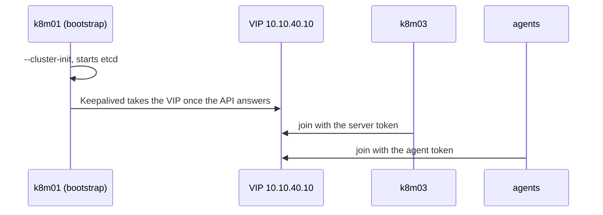

# k3s

The VMs form one Kubernetes cluster running [k3s](https://k3s.io/) 1.35: three
servers with embedded etcd, one per host, and two agents. This repo only
builds the cluster; what runs on it lives in [`hgd1-k8s`](../reference/repositories.md) and app repos.

!!! info "At a glance"

    **Status** <span class="status">Done</span> ·
    **API** `https://k8s.lan.buunk.org:6443` (VIP `10.10.40.10`) ·
    **Configured in** `modules/microvm/guest/k3s/`, `inventory.nix` → `k3s`
    · **Access** `scripts/kubeconfig.sh`

## Overview

| Node | Zone (host) | Role |
| --- | --- | --- |
| `hgd1-k8m01` | hgd1-hv01 | server; created the cluster |
| `hgd1-k8m02` | hgd1-hv02 | server |
| `hgd1-k8m03` | hgd1-hv03 | server |
| `hgd1-k8w01` | hgd1-hv01 | agent |
| `hgd1-k8w02` | hgd1-hv03 | agent |

- **Zones:** each node has `topology.kubernetes.io/zone=<hypervisor>`.
- **Servers run workloads** (no taint): hv02 only has a server, and anything
  spread over three zones needs a schedulable node in each.
- **Networking:** flannel VXLAN over the `k8s` NIC; pods `10.42.0.0/16`,
  services `10.43.0.0/16`.
- **Add-ons:** CoreDNS, metrics-server and `local-path`. Traefik and ServiceLB
  are off; ingress and load balancers come from `hgd1-k8s`.

## How it works

### Joining



`inventory.k3s.bootstrapServer` gets `--cluster-init`; every other node joins
`https://10.10.40.10:6443`. With all three servers in, it is `null`, so every
server (also a rebuilt `k8m01`) joins through the VIP instead of starting an
empty cluster. Set it back to one server only to create a brand new cluster.

### API VIP

Keepalived on the servers moves `10.10.40.10` to a server whose API server
answers (unicast VRRP v3, only from the other servers, no preemption). The
same design as the [S3 endpoint](s3.md#failover).

### Tokens

Two agenix secrets, `k3s-server-token.age` and `k3s-agent-token.age`. Each
host decrypts them into `/run/k3s-secrets/<role>/` for the roles it runs and
shares that directory read-only into the VM. Agents only see the agent
token. Adding a VM needs no re-encryption.

### Persistence

| Path | Why | How |
| --- | --- | --- |
| `/var/lib/rancher/k3s` | etcd, images, certificates | On the `/var/lib` disk |
| `/etc/rancher/node/password` | Servers reject a node whose password changed | Symlink to `/var/lib/rancher/node` |
| Pod logs | Would fill the RAM-backed root | `podLogsDir = /var/lib/kubelet-pod-logs` |

### Firewall

Only on the `k8s` NIC: kubelet 10250 and flannel 8472/udp everywhere; API
6443, etcd 2379–2380 and VRRP from the other servers on servers. Pod
interfaces (`cni0`, `flannel.1`) are trusted. Full list:
[Firewall](../reference/firewall.md#k3s-vms).

### etcd snapshots

Every server snapshots etcd every six hours and keeps 20, in
`/var/lib/rancher/k3s/server/db/snapshots`. They aren't copied off the VMs
yet.

## Configuration

| Piece | File |
| --- | --- |
| API name, VIP, VRRP id, bootstrap server | `inventory.nix` → `k3s` |
| Join URL, token paths | `lib/k3s.nix` |
| Flags, labels, kubelet config, persistence | `modules/microvm/guest/k3s/default.nix` |
| API VIP | `modules/microvm/guest/k3s/api-vip.nix` |
| Ports | `modules/microvm/guest/k3s/firewall.nix` |
| Ceph modules and `hgd1-ceph` ConfigMap | `modules/microvm/guest/k3s/ceph.nix` |
| Tokens on the host | `modules/microvm/host/k3s-secrets.nix` |

## Operating

```sh
scripts/kubeconfig.sh
kubectl get nodes -L topology.kubernetes.io/zone
scripts/k3s-roll.sh                 # restart VMs one at a time, safely
labctl vm restart hgd1-k8w01          # one node, through the Platform API (clusterd v1.0)
```

- [Restart k3s nodes](../how-to/restart-k3s-nodes.md)
- [Manage VMs](../how-to/manage-vms.md): adding or moving nodes

## Tested

- Five Ready nodes with zone labels; three etcd members.
- Restarting `hgd1-k8m01` while it held the API VIP: 41 of 41 API checks
  succeeded and the VIP moved to `hgd1-k8m02`.
- Pods on every node reach each other, cluster DNS, the internet, the Ceph
  monitors and the S3 endpoint; a VM mapped a Ceph RBD image.

## Troubleshooting

See [Troubleshooting → k3s node](../operate/troubleshooting.md#k3s-node-not-ready).

## Related

- [Build an app](../how-to/build-an-app.md) · [VMs](vms.md)
