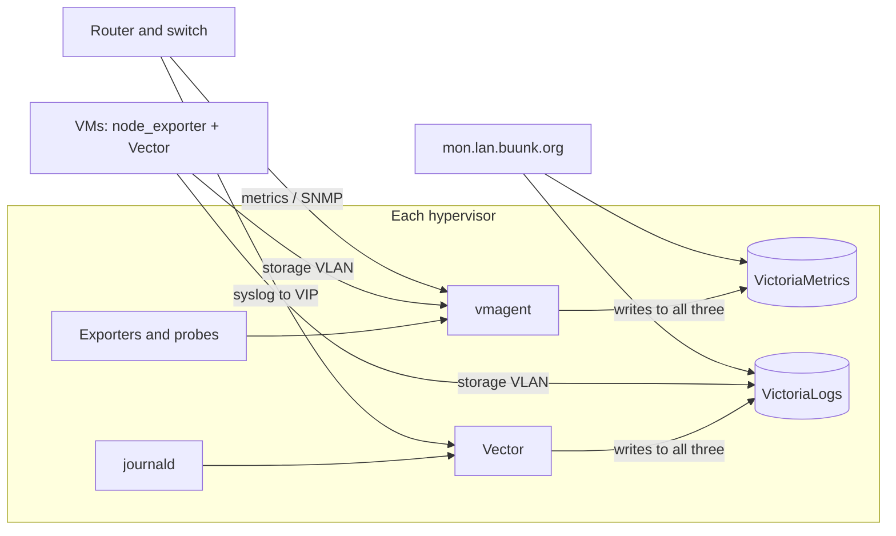

# Monitoring

Metrics and logs for the whole infrastructure: hosts, disks, Ceph, the S3
endpoint, VMs, remote access, router and switch. It runs on the hypervisors
themselves, independent of k3s and Ceph, so it keeps working exactly when
those are broken.

!!! info "At a glance"

    **Status** <span class="status">Done</span> · **Query address**
    `mon.lan.buunk.org` (VIP `10.10.20.10`): metrics on `:8428`, logs on
    `:9428` · **Configured in** `modules/monitoring/`,
    `inventory.nix` → `monitoring` · **Retention** metrics 1 year, logs 90 days

## Overview



- **Every host keeps a full copy.** Each vmagent and Vector writes to all
  three hosts. A host that was down catches up from the others' disk buffers.
- **One query address.** Keepalived moves the VIP to a host whose
  VictoriaMetrics and VictoriaLogs both answer.
- **Data on local NVMe**, not on Ceph: monitoring must not depend on what it
  monitors.
- **Who reads it:** the [Platform API](api.md) proxies the query endpoints with
  token auth, so the `labctl` CLI and the [web UI](web-ui.md) never talk to the
  stores directly. Both stores also have their own web UI over WARP.

## How it works

### Metrics

Each host's vmagent scrapes every 30 seconds:

| Job | Source | Covers |
| --- | --- | --- |
| `node` | node_exporter | CPU, memory, disks, network, systemd units |
| `smartctl` | smartctl_exporter | SMART health and wear of the HDD and NVMe |
| `ceph` | Ceph manager (`:9283`) | Health, OSDs, PGs, pools, capacity |
| `haproxy` | HAProxy (`127.0.0.1:8405`) | S3 frontend and backend state |
| `clusterd` | Platform API (`127.0.0.1:9180`) | Requests, latency, auth failures, store fallbacks |
| `cloudflared` | Tunnel connector (`127.0.0.1:20241`) | Tunnel connections |
| `vm-node` | node_exporter in this host's VMs, over the storage VLAN | VM resources and units |
| `router-node` | OPNsense `os-node_exporter` (`10.10.10.1:9100`) | Router CPU, memory, interfaces |
| `switch-snmp` | snmp_exporter → Aruba (`if_mib`, `system`) | Port traffic, errors, uptime |
| `probe-*` | blackbox_exporter | Ping (including the VIPs), DNS, S3 TLS, `api.lan.buunk.org/v1/health`, k3s API TLS, internet |
| self | VictoriaMetrics, VictoriaLogs, vmagent, Vector | The monitoring itself |

Shared targets (router, switch, Ceph) are scraped by every host;
VictoriaMetrics deduplicates them, so they stay visible when one host is down.
Probes carry a `probe_from` label, so each host's view of the network is kept
separately.

### Logs

Vector collects journald on every host and VM, and receives syslog from the
router and switch on the VIP (UDP and TCP 514). Every record gets a `host`
(short name) and a `unit` (systemd unit or syslog app). Syslog records use the
time they arrive, because classic syslog carries no timezone.

### Query address

`10.10.20.10` is a Keepalived VIP on the management NIC (VRRP id 20, unicast
between the three hosts). Returning hosts don't take it back.

## Configuration

| File | Owns |
| --- | --- |
| `inventory.nix` → `monitoring` | Name, VIP, VRRP id, retention, router, switch, extra ping targets |
| `modules/monitoring/storage.nix` | VictoriaMetrics and VictoriaLogs |
| `modules/monitoring/collection.nix` | Exporters, probes, vmagent scrape config |
| `modules/monitoring/logs.nix` | Vector on the hosts, syslog listener |
| `modules/monitoring/vip.nix` | Keepalived and its health check |
| `modules/monitoring/firewall.nix` | Ports and VRRP |
| `modules/microvm/guest/monitoring.nix` | node_exporter and Vector in the VMs |
| `lib/logs.nix` | Shared Vector pieces: field cleanup, one buffered sink per host |
| `secrets/snmp-community.age` | snmp_exporter auth file with the switch's read-only community |

On the devices, configured through [`hgd1-network`](https://github.com/jurrebuunk/hgd1-network): OPNsense has the
`os-node_exporter` plugin (listening on `10.10.10.1`) and a syslog destination
to `10.10.20.10`; the Aruba has a read-only SNMP community and
`logging 10.10.20.10`.

## Operating

**Browse** (WARP connected):

- Metrics: <http://mon.lan.buunk.org:8428/vmui/>
- Logs: <http://mon.lan.buunk.org:9428/select/vmui/>

**Query from the command line:**

```sh
labctl metrics query 'probe_success == 0'                  # which probes fail
labctl metrics query 'up == 0'                             # which targets are down
labctl disk list                                           # wear, SMART, fullness of every drive
labctl logs --host hgd1-hv01 --unit ceph-osd-0 --since 1h  # one unit; 'unit:"ceph-osd"*' for all
labctl logs -f --host hgd1-fw01                            # follow the router
```

`labctl` goes through the [Platform API](api.md), which asks this host's store
first and another host's when it's down. Grafana and scripts on the infra
VLAN can still use `http://mon.lan.buunk.org:8428` and `:9428` directly.

**Check scrape targets** on a host:

```sh
ssh jurre@10.10.20.11 'curl -s 127.0.0.1:8429/api/v1/targets' | jq -r '.data.activeTargets[] | "\(.health) \(.labels.job) \(.labels.instance)"'
```

**Through the API** (token auth), the usual way:

```sh
labctl metrics query 'probe_success == 0'
labctl logs --host hgd1-fw01 --since 1h
```

A Grafana can also use `http://mon.lan.buunk.org:8428` (Prometheus type) and
`:9428` (VictoriaLogs) directly; from k3s that needs one OPNsense rule in [`hgd1-network`](https://github.com/jurrebuunk/hgd1-network):
K8S → `10.10.20.10` on TCP 8428 and 9428.

## Troubleshooting

See [Troubleshooting → Monitoring](../operate/troubleshooting.md#monitoring).

## Future

- **Alerting:** vmalert with rule sets for node, Ceph and SMART, and a
  clustered Alertmanager sending notifications.
- **Heartbeat:** an always-firing alert sent to an external service, so a
  completely silent monitoring stack gets noticed.

## Tested

- All 77 scrape targets up across the three hosts; every probe succeeds.
- The three copies hold the same series, also after a store was down.
- Logs from all hosts, all five VMs, the router and the switch on every copy.
- Stopping VictoriaMetrics on the VIP owner moved the VIP; queries kept working.

## Related

- [Platform API](api.md) · [Hosts](hosts.md) · [Ceph](ceph.md) · [Health check](../operate/index.md)
