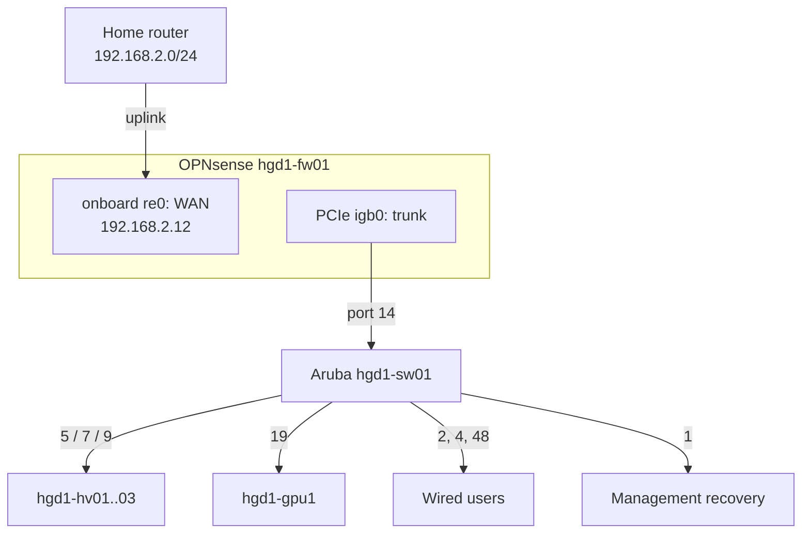

# Network

The site separates management, hosts, storage, Kubernetes and users into
VLANs behind one OPNsense router.

!!! info "At a glance"

    **Status** <span class="status">Done</span> · **Router and switch managed in**
    [`hgd1-network`](https://github.com/jurrebuunk/hgd1-network) (Ansible) · **Host side** `modules/network.nix` · **Addresses** [Addresses](../reference/addresses.md)
    · **Rules** [Firewall](../reference/firewall.md)

## Overview



The internet uplink goes into the router's **onboard NIC**, never into the
switch, so WAN traffic never touches the switch and the home network can't
leak into the internal VLANs. The whole home network counts as WAN: nothing
from home reaches the site unless a rule allows it.

## VLANs

The site uses `10.10.0.0/16`, and the third octet is always the VLAN ID.

| VLAN | Name | Subnet | Gateway | DHCP | What lives there |
| --- | --- | --- | --- | --- | --- |
| 10 | mgmt | `10.10.10.0/24` | `.1` | `.100–.199` | Router, switch |
| 20 | infra | `10.10.20.0/24` | `.1` | no | Hypervisors, `hgd1-gpu1` |
| 30 | storage | `10.10.30.0/24` | none | no | Ceph; **not routed** |
| 40 | k8s | `10.10.40.0/24` | `.1` | no | k3s VMs, API VIP `.10`, load balancers `.200–.249` |
| 100 | users | `10.10.100.0/24` | `.1` | `.100–.249` | Wired users, the gaming VM |

`10.42.0.0/16` and `10.43.0.0/16` stay free for k3s pods and services. The
storage VLAN never reaches the router: only hosts and VMs with a leg in it
can talk Ceph.

## How it works

### Host wiring

Each hypervisor has one cable carrying VLAN 20 untagged and VLANs 30 and 40
tagged. NixOS turns that into:

```text
enp2s0                 10.10.20.1x/24   host management, default route
enp2s0.30 → br-stor    10.10.30.1x/24   Ceph and S3; VM storage NICs attach here
enp2s0.40 → br-k8s     (no address)     VM k8s NICs attach here
```

`br-k8s` has no host address on purpose: the host isn't reachable from the
k8s VLAN, and its firewall drops anything that would route between the
bridges and the rest of the host.

### Switch ports

| Role | Ports | Untagged | Tagged |
| --- | --- | --- | --- |
| Router trunk | 14 | 10 | 20, 40, 100 |
| Hypervisors | 5, 7, 9 | 20 | 30, 40 |
| `hgd1-gpu1` | 19 | 20 | 100 |
| Wired users | 2, 4, 48 | 100 | – |
| Management recovery | 1 | 10 | – |
| Spare router links | 16, 18 | 999, disabled | – |
| Everything else | – | 999, disabled | – |

Port order says nothing about which host is plugged in; confirm by MAC.

### Firewall

Everything between VLANs is denied unless allowed. In short: mgmt reaches
everything; infra, k8s and users reach the internet and the router's DNS and
NTP; users also reach Kubernetes load balancers on 80 and 443; the three
hypervisors may forward into mgmt, k8s and users for remote access. The full
table is in [Firewall](../reference/firewall.md).

### DNS and time

OPNsense runs Unbound with DNSSEC for `lan.buunk.org` and serves NTP. Fixed
addresses have host overrides such as `hgd1-hv01.lan.buunk.org`,
`s3.lan.buunk.org`, `k8s.lan.buunk.org`, `mon.lan.buunk.org`,
`api.lan.buunk.org` and `lab.buunk.org` (internal for now). Hosts also keep each other in
`/etc/hosts`, so they resolve each other when the router is down. Ceph needs
synced clocks, so hosts run chrony and prefer OPNsense.

### Game streaming

My gaming VM on `hgd1-gpu1` runs Sunshine. Home Moonlight clients connect to
the router's WAN address `192.168.2.12`, which forwards the Sunshine ports to
`10.10.100.50`. On the users VLAN, use `10.10.100.50` directly. The admin UI,
RDP and discovery are not forwarded.

!!! warning "Keep \"Block private networks\" off on WAN"

    The WAN *is* a private network (my home LAN), so that checkbox would block
    the streaming forwards. Default deny plus the narrow forwards protect the
    site.

## Configuration

| What | Where |
| --- | --- |
| VLANs, DHCP, DNS overrides, firewall, NAT on OPNsense | [`hgd1-network`](https://github.com/jurrebuunk/hgd1-network) |
| VLANs and port roles on the Aruba | [`hgd1-network`](https://github.com/jurrebuunk/hgd1-network) |
| Host side | `modules/network.nix`, `modules/microvm/host/networking.nix` |
| Addresses | `inventory.nix` → `vlans`, `hosts`, `vms` |

The router and switch are not managed by Nix: their configuration is code in
the private [`hgd1-network`](../reference/repositories.md) repo (Ansible), and
exports are backed up as files outside Git, because they contain password
hashes and keys.

## Operating

- Router and switch changes, backups and updates: [`hgd1-network`](https://github.com/jurrebuunk/hgd1-network). What's configured
  and how to reach the devices: [Router and switch](../operate/router-and-switch.md).
- Building it all again: [Rebuild the network](../operate/rebuild-network.md).

## Troubleshooting

- **Can't reach anything:** see [Troubleshooting → No access](../operate/troubleshooting.md#no-access).
- **A host lost its network after a change:** use the console or the
  previous boot generation; see [Roll back](../how-to/roll-back.md).

## Related

- [Remote access](remote-access.md)
- [Addresses](../reference/addresses.md) · [Firewall](../reference/firewall.md)
- Future ideas (Wi-Fi, guest and IoT VLANs, DMZ, LACP) are on the
  [roadmap](../reference/roadmap.md).
