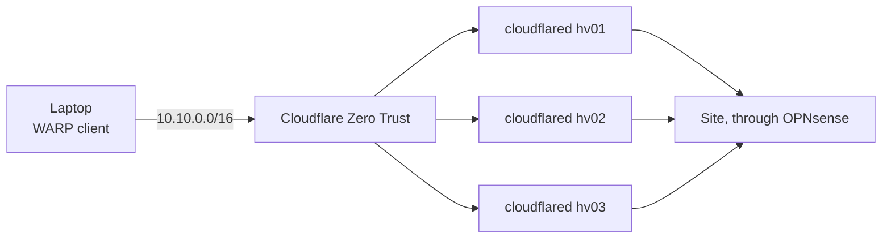

# Remote access

I reach the whole site (`10.10.0.0/16`) from anywhere as if I were plugged in:
SSH, the router and switch, the Kubernetes API and internal names. There are
no inbound ports; Cloudflare carries the traffic.

!!! info "At a glance"

    **Status** <span class="status">Done</span> · **Configured in**
    `modules/remote-access.nix`, `inventory.nix` → `remoteAccess`, the
    Cloudflare Zero Trust dashboard (team `buunk`) · **Secret**
    `secrets/cloudflared-tunnel.age`

## Overview



Nothing in the cluster depends on this path. If Cloudflare is down, the site
keeps working; only my remote access is gone. It is also what makes managing
possible from outside: the [Platform API](api.md), and so the `labctl` CLI and
the web UI, only answer on the infra VLAN.

## How it works

- **One tunnel, three connectors.** Tunnel `hgd1-admin` runs on all three
  hypervisors. Each connector dials out to Cloudflare; any one keeps access up.
- **The tunnel announces `10.10.0.0/16`**, in the virtual network
  `hgd1-admin`. Cloudflare sends my traffic to a healthy connector, and the
  hypervisor forwards it through OPNsense.
- **Admin only when needed.** The WARP client stays on the virtual network
  `default` all day (internal apps of `hgd1-k8s` work there, see
  [Internal access](https://jurrebuunk.github.io/hgd1-k8s/concepts/internal-access/));
  I switch to `hgd1-admin` to reach the site.
- **The WARP client** on my laptop is enrolled in the Zero Trust
  organisation. Only my email address can enrol.
- **Split tunnel, Include mode.** Only `10.10.0.0/16` and the team domain go
  through WARP. Everything else uses the normal connection.
- **Internal names work.** Local Domain Fallback sends `lan.buunk.org`
  queries to OPNsense (`10.10.20.1`).
- **Servers see the hypervisor as the source**, not the laptop. Who may
  connect is decided in Cloudflare.

## Security

| Layer | Rule |
| --- | --- |
| Enrolment | Access policy: only my email, one-time PIN login |
| Gateway | Block storage `10.10.30.0/24` for everyone; allow `10.10.0.0/16` for my email; block it for everyone else (rules 500, 1000, 2000; the internal apps' rules are 1100 and 2100) |
| OPNsense | Only `10.10.20.11–13` may forward into mgmt, k8s and users |
| Storage | Not routed at all, and blocked in Gateway as a second line |

Gateway proxies TCP, UDP and ICMP. ICMP is only there so `ping` works; Gateway
can't filter it, so storage addresses answer pings while TCP and UDP to them
stay blocked.

## Configuration

| Piece | Where |
| --- | --- |
| Tunnel ID, routes | `inventory.nix` → `remoteAccess` |
| `cloudflared` service | `modules/remote-access.nix` |
| Tunnel credentials | `secrets/cloudflared-tunnel.age`, plus a copy in my password manager |
| Enrolment, device profile, Gateway rules | Zero Trust dashboard |
| OPNsense rule | Aliases `HGD1_TUNNEL_HOSTS` → `HGD1_TUNNEL_DESTS` on INFRA, in [`hgd1-network`](https://github.com/jurrebuunk/hgd1-network) |
| Laptop | My NixOS config: `services.cloudflare-warp.enable = true` |

## Operating

```sh
warp-cli connect                                          # always on
warp-cli vnet 84c40b26-4fac-4131-a48a-9db3ca63267c        # hgd1-admin: manage the site
warp-cli vnet 21a5b1d6-194b-4826-963d-d3352e64dfe5        # default: day to day
labctl metrics query 'cloudflared_tunnel_ha_connections'  # 4 per host is healthy
```

On the users VLAN at home, stay on `default` unless managing: on
`hgd1-admin` site traffic goes out to Cloudflare and back instead of
straight through OPNsense. `*.lan.buunk.org` names only resolve on
`hgd1-admin` (Local Domain Fallback to `10.10.20.1`, reached through the route).

### Setting it up again

Only after the hosts are on their static addresses:

1. **Organisation:** Zero Trust on the Free plan, one-time PIN login, a device
   enrolment rule allowing only your email.
2. **Tunnel:** from the dev shell:

    ```sh
    cloudflared tunnel login
    cloudflared tunnel create hgd1-admin
    cloudflared tunnel vnet add hgd1-admin
    cloudflared tunnel route ip add --vnet hgd1-admin 10.10.0.0/16 hgd1-admin
    ```

    Put the UUID in `inventory.nix` → `remoteAccess.tunnelId`.

3. **Secret:** encrypt `~/.cloudflared/<UUID>.json` as
   `secrets/cloudflared-tunnel.age` ([Manage secrets](../how-to/manage-secrets.md)),
   store a copy in your password manager, delete the JSON.
4. **Deploy** one host at a time; the dashboard shows three connectors.
5. **Device profile:** Include mode with `10.10.0.0/16` and the team domain;
   Local Domain Fallback for `lan.buunk.org` to `10.10.20.1`.
6. **Gateway:** proxy TCP, UDP and ICMP on; add the three network rules.
7. **OPNsense:** the two aliases and the INFRA rule above the INFRA deny, through [`hgd1-network`](https://github.com/jurrebuunk/hgd1-network).
8. **Laptop:** `warp-cli registration new buunk`, `warp-cli connect`.

Verify from outside (a phone hotspot): `ssh jurre@10.10.20.11 hostname`,
`getent hosts hgd1-hv02.lan.buunk.org`, `curl -k https://10.10.10.1`. Then
stop `cloudflared` on one host and check again.

## Troubleshooting

- **Nothing reachable:** `warp-cli status`, then the tunnel's connectors in
  the dashboard. See [Troubleshooting → No access](../operate/troubleshooting.md#no-access).
- **Names don't resolve:** on the virtual network `default`? Switch to
  `hgd1-admin`. Otherwise check Local Domain Fallback in the device profile.
- **Storage unreachable:** that's intended. Use an SSH forward
  ([S3 endpoint](s3.md#from-the-laptop)).

## Limits

- The site can't open connections back to the laptop; that would need
  Cloudflare Mesh.
- No mDNS or DHCP over the tunnel.
- The Free plan covers this easily (one user, three connectors).

## Related

- [Network](network.md) · [Get access](../get-started/access.md)
