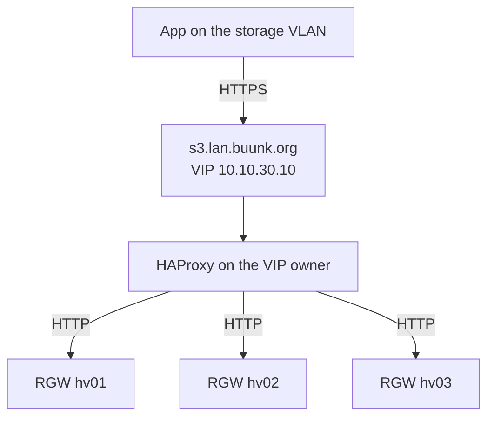

# S3 endpoint

Applications use one stable address for object storage:
**`https://s3.lan.buunk.org`**. It has a publicly trusted certificate, keeps
working when a host goes down, and doesn't depend on Kubernetes.

!!! info "At a glance"

    **Status** <span class="status">Done</span> · **VIP** `10.10.30.10:443`
    (storage VLAN) · **Configured in** `modules/s3-ha/`,
    `inventory.nix` → `ceph.s3` · **Clients** region `us-east-1`, SigV4,
    path-style

## Overview



- **One floating IP.** Keepalived on the three hosts gives `10.10.30.10` to
  exactly one of them.
- **HAProxy terminates TLS** and sends each request to any healthy gateway.
  All gateways share one object store.
- **No rewriting.** S3 signatures and presigned URLs stay valid.
- **Storage VLAN only.** No public exposure.

Use path-style addressing (`https://s3.lan.buunk.org/<bucket>/<key>`);
wildcard bucket hostnames aren't configured.

## How it works

### Failover

The VIP belongs to a host whose **proxy works**, not one where Ceph is
healthy. Keepalived checks a loopback TLS listener (`127.0.0.1:9443`) with
full certificate validation:

- a host whose local RGW or Ceph is down **keeps** the VIP; its proxy uses the
  other gateways;
- a host whose HAProxy stops, or that only has a self-signed or staging
  certificate, **loses** it;
- a returning host doesn't take it back (no preemption).

VRRP is unicast between the three storage addresses, accepted only from those
peers with TTL 255. A switchover takes about five seconds; open connections
break and clients retry, which every S3 SDK does. VRRP isn't a quorum
protocol: it covers host and service failures, not a split network.

### Certificates

Each host gets its own Let's Encrypt certificate through **DNS-01** at
Cloudflare, so no public record or open port is needed. Renewal runs daily
with jitter and reloads HAProxy gracefully. The Cloudflare token is in
`secrets/s3-acme-cloudflare.age` and reaches the renewal service as a systemd
credential.

!!! warning "Token scope"

    The current token is the broad one `cloudflared` created at login.
    Replace it with a token limited to DNS edit on `buunk.org`; update the
    secret before revoking the old one.

## Configuration

| File | Owns |
| --- | --- |
| `inventory.nix` → `ceph.s3` | Hostname, VIP, VRRP router ID, ACME email and server |
| `modules/s3-ha/default.nix` | Imports and inventory checks |
| `modules/s3-ha/tls.nix` | ACME, DNS-01 credentials, renewal |
| `modules/s3-ha/proxy.nix` | HAProxy listeners and backends |
| `modules/s3-ha/failover.nix` | Keepalived and the health check |
| `modules/s3-ha/firewall.nix` | HTTPS and VRRP on `br-stor` only |

The DNS record `s3.lan.buunk.org → 10.10.30.10` is a host override on
OPNsense, managed in [`hgd1-network`](https://github.com/jurrebuunk/hgd1-network). Certificate state lives in `/var/lib/acme/` on each host, with
encrypted backups under `~/.local/state/nix-hgd1-cluster/s3-ha/` on my laptop.

## Operating

```sh
labctl status s3                          # gateways, users, buckets with size and quota, room, certificate
labctl status vip                         # exactly one owner of s3
labctl logs --unit haproxy --since 1h     # requests (without object paths)
labctl logs --unit keepalived --since 1d  # VIP moves
```

Users and buckets: [Create an S3 user](../how-to/create-s3-user.md).
HAProxy logs leave out object paths and presigned query strings on purpose.

### From the laptop

Gateway blocks storage, so use an SSH forward. This keeps the hostname and
certificate check intact:

```sh
ssh -N -L 127.0.0.1:17443:10.10.30.10:443 jurre@10.10.20.11
curl --connect-to s3.lan.buunk.org:443:127.0.0.1:17443 https://s3.lan.buunk.org/
```

Don't use `https://127.0.0.1` with certificate checks off.

## Troubleshooting

See [Troubleshooting → S3](../operate/troubleshooting.md#s3-not-answering).

## Tested

- SigV4, odd and Unicode names, presigned URLs and 12 MiB multipart uploads,
  byte-for-byte through the VIP.
- A local Ceph/RGW outage left the VIP in place while S3 kept working.
- Stopping HAProxy or Keepalived moved the VIP; an interrupted upload retried
  and completed.
- Rebooting the VIP owner moved the VIP; Ceph returned to HEALTH_OK.
- HAProxy and Keepalived use about 20–31 MiB per host.

## Related

- [Ceph](ceph.md) · [Build an app](../how-to/build-an-app.md)
