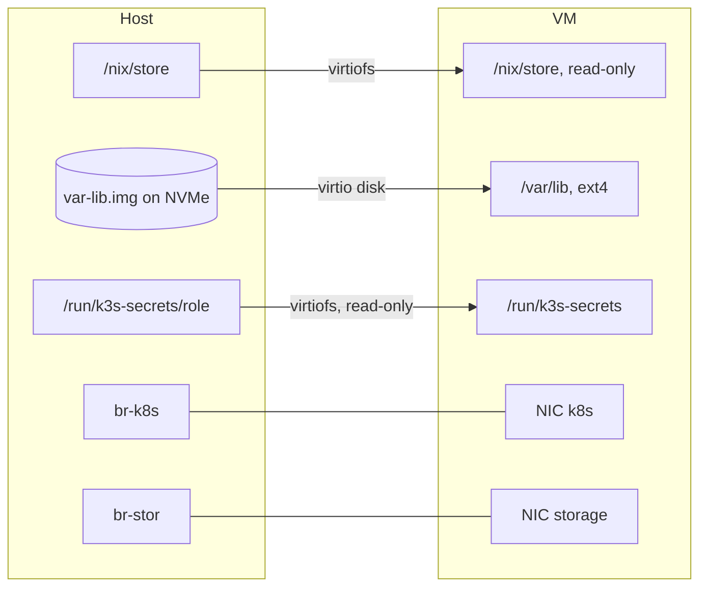

# VMs

The k3s nodes are small QEMU VMs managed by
[microvm.nix](https://github.com/microvm-nix/microvm.nix). Each VM is a NixOS
configuration in this flake and runs on its host as `microvm@<name>`. VMs exist
only because the inventory says so.

!!! info "At a glance"

    **Status** <span class="status">Done</span> · **Configured in**
    `inventory.nix` → `vms`, `modules/microvm/` · **Operate**
    `labctl status vm`, `labctl vm restart` · **How-to** [Manage VMs](../how-to/manage-vms.md)

## Overview

| VM | Host | Role | k8s IP | Storage IP | vCPU / RAM / disk |
| --- | --- | --- | --- | --- | --- |
| `hgd1-k8m01` | hv01 | server | `10.10.40.11` | `10.10.30.21` | 2 / 4 GiB / 60 GiB |
| `hgd1-k8m02` | hv02 | server | `10.10.40.12` | `10.10.30.22` | 2 / 4 GiB / 60 GiB |
| `hgd1-k8m03` | hv03 | server | `10.10.40.13` | `10.10.30.23` | 2 / 4 GiB / 60 GiB |
| `hgd1-k8w01` | hv01 | agent | `10.10.40.21` | `10.10.30.31` | 4 / 4 GiB / 60 GiB |
| `hgd1-k8w02` | hv03 | agent | `10.10.40.22` | `10.10.30.32` | 4 / 4 GiB / 60 GiB |

## How it works



### Disks

- **Root is a tmpfs.** Everything outside `/var/lib` is rebuilt from Nix on
  each boot.
- **`/var/lib` is one ext4 image** on the host's NVMe,
  `/var/lib/microvms/<name>/var-lib.img`. It's sparse, so 60 GiB is a
  maximum. It holds k3s, etcd, containerd, pod logs and the SSH host key.
- **The Nix store is shared read-only** from the host over virtiofs.

### Network

- `k8s` NIC on `br-k8s`: default route, DNS and NTP through `10.10.40.1`,
  SSH allowed here only.
- `storage` NIC on `br-stor`: no gateway, used for Ceph, S3 and monitoring
  (node_exporter on 9100 for the host, logs to every host's VictoriaLogs).
- NIC names are matched by MAC. MACs and TAP names derive from the VM's `id`
  (`id = 11` → `tap11-k8s`, `02:00:00:40:00:0b`). Never change an id.

### Updates

A host deploy installs a new runner (`/var/lib/microvms/<name>/current`) but
**never restarts the VM** (`restartIfChanged = false`), so one deploy can't
take down all VMs on a host. The VM keeps running the version it booted
(`booted`) until you restart it with
[Restart k3s nodes](../how-to/restart-k3s-nodes.md). A VM whose host reboots
starts again automatically.

### Isolation

- The host has no address on `br-k8s`, and its firewall drops input from it
  and any routing between the bridges and the host.
- Host SSH listens only on the management NIC; tests confirmed a VM can't
  reach it through either bridge.
- QEMU's bridge helper is disabled; only declared TAPs are used.

### Host keys

A new VM generates its SSH key on first boot and prints the **public** part
on its serial console. You read it from the trusted host's journal and pin it
in the inventory, instead of trusting whatever answers on the network.

## Configuration

| File | Owns |
| --- | --- |
| `inventory.nix` → `vms` | Placement, role, resources, id, IPs, host key |
| `lib/vm-network.nix` | MACs and TAP names from the id |
| `modules/microvm/host/default.nix` | Which VMs run here, autostart, no restart on change |
| `modules/microvm/host/validation.nix` | Unique ids and IPs, VLANs, memory limit, KVM |
| `modules/microvm/host/networking.nix` | TAPs on bridges, isolation firewall |
| `modules/microvm/host/k3s-secrets.nix` | k3s tokens shared into the VMs |
| `modules/microvm/guest/default.nix` | QEMU resources, shares, the `/var/lib` volume |
| `modules/microvm/guest/networking.nix` | NIC names, addresses, routes, DNS |
| `modules/microvm/guest/access.nix` | Users, SSH, host key report |
| `modules/microvm/guest/monitoring.nix` | node_exporter and Vector |

The inventory checks refuse more than 11 GiB of VM memory per host and
guests on a host without KVM.

## Operating

```sh
labctl status vm                                  # every VM and its state
labctl status disk                                # their /var/lib filesystems, how full
labctl logs --unit microvm@hgd1-k8m01 --since 1h  # the VM's console, from its host
labctl logs --host hgd1-k8m01 --since 1h          # inside the VM
labctl vm restart hgd1-k8m01                      # drain, restart, Ready, uncordon
```

`scripts/vm.sh <vm> start|stop` and `ssh jurre@10.10.40.11` remain for what
the API doesn't do: stopping a VM for good, and a shell inside it.

!!! warning "vm.sh doesn't know about Kubernetes"

    It restarts without draining or checking quorum. For k3s nodes use
    [Restart k3s nodes](../how-to/restart-k3s-nodes.md).

## Troubleshooting

See [Troubleshooting → k3s node](../operate/troubleshooting.md#k3s-node-not-ready).

## Related

- [Manage VMs](../how-to/manage-vms.md) · [k3s](k3s.md) · [Hosts](hosts.md)
