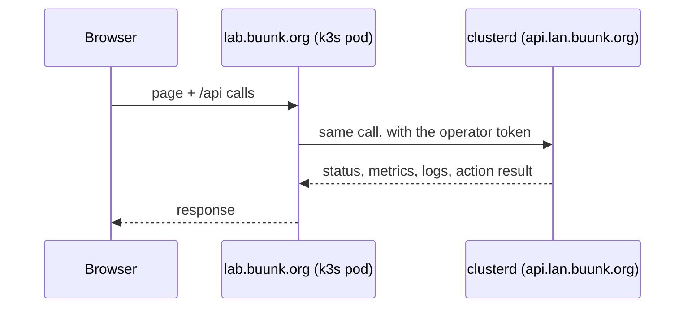

# Web UI

!!! repo "Lives in its own repo: lab-console"

    This page covers **the web UI (`lab-console`)** on the hgd1 cluster: how it fits in and how I
    use it here. Code, development, releases and the full documentation are in
    the repo.

    [:fontawesome-brands-github: jurrebuunk/lab-console](https://github.com/jurrebuunk/lab-console){ .md-button .md-button--primary }

**`lab-console`**, the browser dashboard at **`https://lab.buunk.org`**:
health of hosts, VMs, k3s and Ceph, metrics, logs and a few safe actions,
from any device. It talks to the platform only through the
[Platform API](api.md), and it isn't tied to this one site.

!!! info "At a glance"

    **Status** In development ·
    **Runs on** k3s, deployed by Flux from `hgd1-k8s` · **Talks to**
    `clusterd` with an `operator` token

## Overview

- **Frontend and a thin proxy in one pod.** The pod serves the static
  frontend and forwards `/api` to `clusterd`. The browser never holds an API
  token, and `clusterd` never has to be public.
- **Scope `operator`:** everything a `read` token sees, plus the few actions I
  allow from anywhere. `manage` stays with the CLI over WARP.
- **A broken console never affects the platform.** It can be rebuilt or moved
  freely; the CLI keeps working without it.

## Access

| Stage | How you reach it |
| --- | --- |
| Now | Internal only: `lab.buunk.org` points to a load balancer IP in VLAN 40 (`10.10.40.200–249`); reachable over WARP |
| Later | Public through a Cloudflare Tunnel from `hgd1-k8s`, with login through **Keycloak** (OIDC). It only goes public once Keycloak is in front of it |

## How it works

| Part | Detail |
| --- | --- |
| Frontend | A small single-page app; flatwork-ui colours (`#1b1818`, `#8aa1a8`) |
| Proxy | Caddy or nginx in the same pod, adds the token from a Kubernetes Secret |
| Token | An `operator` token, encrypted with sops in `hgd1-k8s` |
| Network | One OPNsense rule in [`hgd1-network`](https://github.com/jurrebuunk/hgd1-network): K8S → `10.10.20.20:443` (the API VIP) |
| Data | `/v1/status`, `/v1/metrics/query_range`, `/v1/logs/query` |
| Actions | `/v1/actions/…`; every action shows what it will do and asks for confirmation |
| Delivery | CI builds `ghcr.io/jurrebuunk/lab-console`; Flux rolls out new images |

## Configuration

Code, image and Kubernetes manifests live in `lab-console`; Flux and the
token Secret in `hgd1-k8s`. This repo only provides the API it talks to.

## Develop

Building, running locally and releasing the web UI happen in
[`lab-console`](https://github.com/jurrebuunk/lab-console); deploying it in
[`hgd1-k8s`](https://github.com/jurrebuunk/hgd1-k8s). This page stays the
place to understand how it fits into the platform.

## Troubleshooting

See [Troubleshooting → API](../operate/troubleshooting.md#api).

## Related

- [Platform API](api.md) · [Use the CLI](../how-to/use-the-cli.md) ·
  [Repositories](../reference/repositories.md)
