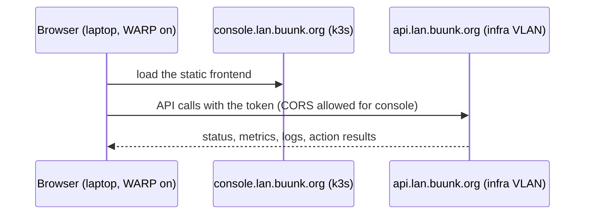

# Web UI

A browser dashboard for the platform at **`https://console.lan.buunk.org`**:
health of hosts, VMs, k3s and Ceph, metrics and logs, and the same actions as
the CLI. It is only a frontend; everything it shows or does goes through the
[Platform API](api.md).

!!! info "At a glance"

    **Status** In development ·
    **Runs on** the k3s cluster, deployed from the workloads repo ·
    **Talks to** `https://api.lan.buunk.org` · **Needs** WARP and an API token

## Overview

- **Static frontend.** k3s serves HTML, CSS and JavaScript, nothing more. It
  holds no secrets and has no backend of its own.
- **The browser calls the API directly.** The API is on the infra VLAN, so the
  console only works with WARP connected (or from the management VLAN). Without
  it the page loads and tells you to connect WARP.
- **Same rules as the CLI.** A `read` token shows everything; a `manage` token
  also enables the action buttons.

## How it works

| Part | Detail |
| --- | --- |
| Address | `console.lan.buunk.org`, a k3s ingress on a load balancer IP in VLAN 40 (`.200–.249`) |
| Login | Paste an API token once; it's kept in the browser's session storage, never in a cookie |
| CORS | The API only accepts browser calls from the origin in `inventory.nix` → `api.webOrigin` |
| Data | Status from `/v1/status`, charts from `/v1/metrics/query_range`, logs from `/v1/logs/query` |
| Actions | Calls the `/v1/actions/…` endpoints; every action shows what it will do and asks for confirmation |
| Look | flatwork-ui colours: background `#1b1818`, primary `#8aa1a8` |

Because the console is only a frontend, it can be rebuilt or moved freely; a
broken console never affects the platform. The CLI keeps working without it.

## Configuration

The frontend's code and Kubernetes manifests live in the workloads repo. This
repo only sets the allowed origin (`inventory.nix` → `api.webOrigin`) and the
DNS name on OPNsense.

## Operating

- Open <https://console.lan.buunk.org> with WARP connected and log in with a
  token from [Use the CLI → Tokens](../how-to/use-the-cli.md#tokens).
- Logged-out or no data: check WARP first, then `hgd1 status`.

## Related

- [Platform API](api.md) · [Use the CLI](../how-to/use-the-cli.md) ·
  [Monitoring](monitoring.md)
