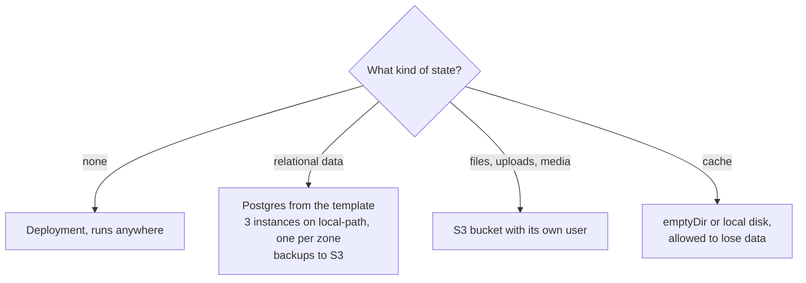

# Build an app

!!! repo "Lives in its own repo: hgd1-k8s"

    This page covers **building an app on the cluster** on the hgd1 cluster: how it fits in and how I
    use it here. Code, development, releases and the full documentation are in
    the repo.

    [:fontawesome-brands-github: jurrebuunk/hgd1-k8s](https://github.com/jurrebuunk/hgd1-k8s){ .md-button .md-button--primary }

This page is for building something on the platform: a new app, a database,
a service that needs storage. You don't need to know NixOS for that. The
contract between this repo and your project is a **Kubernetes API**, the
**S3 endpoint** and the **Ceph cluster**.

## Platform

| You get | Details |
| --- | --- |
| Kubernetes API | `https://k8s.lan.buunk.org:6443`, k3s 1.35, five nodes (three schedulable servers, two agents) once finished |
| Zones | `topology.kubernetes.io/zone` = `hgd1-hv01`, `hgd1-hv02`, `hgd1-hv03`; one zone per physical host |
| Local disks | `local-path` StorageClass on each node's NVMe |
| Object storage | `https://s3.lan.buunk.org`, path-style, region `us-east-1` |
| Egress | Internet from pods (image registries, APIs) |
| Internal DNS | `*.lan.buunk.org` names resolve inside pods |

**Not part of this repo** (they come from `hgd1-k8s`): public access
through a Cloudflare Tunnel, the Postgres operator with its template,
Keycloak for logins, and monitoring of pods. Until those exist, services only
work inside the cluster. Local ingress for LAN-only services comes later.

## Access

```sh
git clone https://github.com/jurrebuunk/nix-hgd1-cluster
cd nix-hgd1-cluster && nix develop
warp-cli connect
kubeconfig                  # ~/.kube/hgd1.yaml
export KUBECONFIG=~/.kube/hgd1.yaml
kubectl get nodes -L topology.kubernetes.io/zone
```

`hgd1-k8s` and app repos need nothing from this flake, only that file.
Tools like Helm, Terraform, Flux or Argo CD can all use it.

## Where state goes

Ask this for every new app. The answer is almost always "Postgres", "S3" or
"nowhere".



The rules behind it:

1. Stateless apps can run anywhere.
2. Databases use a replicating operator (CloudNativePG): three instances on
   `local-path`, spread over zones, with continuous backups to S3. Use the
   shared template once it exists.
3. Files and user data go to S3, never `local-path`.
4. Caches may use local storage and may lose data.
5. **Never** put a single, non-replicated volume on `local-path`. When that
   node's host dies, the data is gone.
6. There is no Ceph block storage for pods (no ceph-csi): an app that only
   works with one plain disk doesn't fit this platform; give it Postgres or
   S3 instead.

Why: the Ceph HDDs are reliable but slow (three laptop disks over 1 GbE), and
the NVMe is fast but local to one host. Databases get speed from NVMe and
safety from replicating themselves; files get safety from Ceph through S3.

## Spreading

Use the zone label so replicas don't end up on one physical machine:

```yaml
topologySpreadConstraints:
  - maxSkew: 1
    topologyKey: topology.kubernetes.io/zone
    whenUnsatisfiable: DoNotSchedule
    labelSelector:
      matchLabels:
        app: my-app
```

Two nodes share hv01 and two share hv03, so spreading by node name alone isn't
enough.

## Object storage

Every node has a NIC on the storage VLAN, so pods reach
`https://s3.lan.buunk.org` directly with a valid certificate.

1. Create a user for your app ([Create an S3 user](create-s3-user.md)).
2. Put its keys in a Kubernetes Secret through sops in `hgd1-k8s` or your app repo's secret
   handling. Never put them in plain text in Git.
3. Configure the client: endpoint `https://s3.lan.buunk.org`, region
   `us-east-1`, path-style addressing.

The endpoint is only reachable inside the network. A public app must pass
uploads and downloads through itself (Cloudreve's proxy setting, for
example), never hand browsers presigned URLs to `s3.lan.buunk.org`.

## Exposing

Public apps go out through a Cloudflare Tunnel that runs in the cluster
(`hgd1-k8s`): a route "hostname → Service" in Git publishes it, Cloudflare
handles TLS, and no port on the network is opened. Apps that need a login
use Keycloak (`auth.buunk.org`) over OIDC. The first one is Cloudreve.

Services that only need to be reachable on the LAN come later, with an
ingress controller on load balancer IPs in VLAN 40 (`10.10.40.200–249`).

## Checklist

- [ ] Where does its state go (the diagram above)?
- [ ] Deployment with at least two replicas if it must survive a host loss,
      with a zone spread constraint.
- [ ] Its own S3 user and bucket if it stores files (`labctl s3 user create`,
      `labctl s3 bucket create`).
- [ ] Public? A tunnel route in `hgd1-k8s`, and a Keycloak client if it has
      users.
- [ ] Postgres from the template if it needs a database.
- [ ] Secrets through sops (`hgd1-k8s`) or your app repo's secret handling, never plain text.
- [ ] Requests and limits set: a node has 4 GiB of RAM in total.
- [ ] Tested: `labctl vm stop <vm>` on the VM it runs on, check the app keeps
      working, then `labctl vm start <vm>`.

## Monitoring

Your app's own metrics and logs are collected by `hgd1-k8s` (vmagent and Vector). For the
platform's data, use the [CLI](use-the-cli.md), the [web UI](../concepts/web-ui.md)
or the [API](../reference/api.md) (`/v1/metrics`, `/v1/logs`, token auth). A
Grafana in `hgd1-k8s` can also read the stores directly:

| Data source | URL |
| --- | --- |
| Prometheus (VictoriaMetrics) | `http://mon.lan.buunk.org:8428` |
| VictoriaLogs (plugin) | `http://mon.lan.buunk.org:9428` |

From k3s that needs one OPNsense rule in [`hgd1-network`](https://github.com/jurrebuunk/hgd1-network): K8S → `10.10.20.10` on TCP 8428 and
9428. See [Monitoring](../concepts/monitoring.md).

## Platform changes

If your project needs something from the platform (another VM, more memory,
a firewall rule, a new VLAN), that change happens in this repo. Read
[Tour of the repo](../get-started/repository.md) and
[Deploy a change](deploy.md) first.
