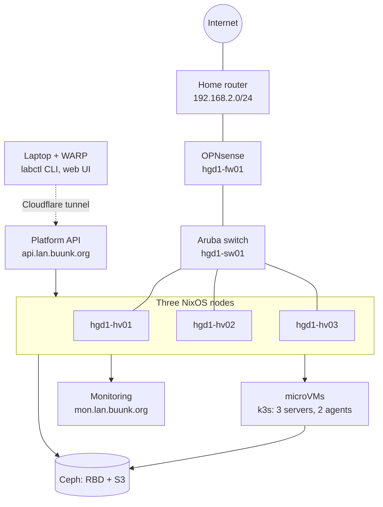

# hgd1 Cluster

My homelab at site **hgd1**: three small x86 machines running NixOS, Ceph
storage, an S3 endpoint and the VMs of a k3s cluster. Everything here is
code in [`nix-hgd1-cluster`](https://github.com/jurrebuunk/nix-hgd1-cluster),
deployed from my laptop.

The homelab's docs are three sites, each covering only what its repo owns:

<svg xmlns="http://www.w3.org/2000/svg" fill="none" stroke="currentColor" stroke-linecap="round" stroke-linejoin="round" stroke-width="2" viewBox="0 0 24 24"><rect width="20" height="8" x="2" y="2" rx="2" ry="2"/><rect width="20" height="8" x="2" y="14" rx="2" ry="2"/><path d="M6 6h.01M6 18h.01"/></svg>Clusternix-hgd1-clusterHosts, Ceph, S3, microVMs, the k3s nodes, monitoring, remote access, the Platform API and <code>labctl</code>.You're here

<a class="site site--k8s" href="https://jurrebuunk.github.io/hgd1-k8s/"><svg xmlns="http://www.w3.org/2000/svg" fill="none" stroke="currentColor" stroke-linecap="round" stroke-linejoin="round" stroke-width="2" viewBox="0 0 24 24"><circle cx="12" cy="12" r="8"/><path d="M12 2v7.5M19 5l-5.23 5.23M22 12h-7.5M19 19l-5.23-5.23M12 14.5V22M10.23 13.77 5 19M9.5 12H2M10.23 10.23 5 5"/><circle cx="12" cy="12" r="2.5"/></svg>Kuberneteshgd1-k8sWhat runs on k3s: Flux, public access, Postgres, Keycloak, and how to run an app.Open the docs <svg xmlns="http://www.w3.org/2000/svg" fill="none" stroke="currentColor" stroke-linecap="round" stroke-linejoin="round" stroke-width="2" viewBox="0 0 24 24"><path d="M5 12h14M12 5l7 7-7 7"/></svg></a>
<a class="site site--network" href="https://jurrebuunk.github.io/hgd1-network/"><svg xmlns="http://www.w3.org/2000/svg" fill="none" stroke="currentColor" stroke-linecap="round" stroke-linejoin="round" stroke-width="2" viewBox="0 0 24 24"><rect width="6" height="6" x="16" y="16" rx="1"/><rect width="6" height="6" x="2" y="16" rx="1"/><rect width="6" height="6" x="9" y="2" rx="1"/><path d="M5 16v-3a1 1 0 0 1 1-1h12a1 1 0 0 1 1 1v3M12 12V8"/></svg>Networkhgd1-networkThe OPNsense router, the Aruba switch, the VLANs and the firewall between them.Open the docs <svg xmlns="http://www.w3.org/2000/svg" fill="none" stroke="currentColor" stroke-linecap="round" stroke-linejoin="round" stroke-width="2" viewBox="0 0 24 24"><path d="M5 12h14M12 5l7 7-7 7"/></svg></a>

I wrote these docs mainly for myself, to maintain the setup months from now
without rediscovering it. They're also written so anyone can understand the
whole project, build on top of it or take over its maintenance.

-   :lucide-rocket:{ .lg .middle } **Get started**

    ---

    Get access, make your first change and find your way around the repo.

    [:octicons-arrow-right-24: Get started](get-started/index.md)

-   :lucide-lightbulb:{ .lg .middle } **Concepts**

    ---

    How the network, hosts, storage and Kubernetes fit together, and why.

    [:octicons-arrow-right-24: Concepts](concepts/index.md)

-   :lucide-wrench:{ .lg .middle } **How-to guides**

    ---

    Short, numbered steps for one task each: deploy, add a VM, add a secret.

    [:octicons-arrow-right-24: How-to](how-to/index.md)

-   :lucide-heart-pulse:{ .lg .middle } **Operate**

    ---

    Health checks, maintenance, troubleshooting and disaster recovery.

    [:octicons-arrow-right-24: Operate](operate/index.md)

-   :lucide-book-open:{ .lg .middle } **Reference**

    ---

    Every address, port, script, inventory field and term in one place.

    [:octicons-arrow-right-24: Reference](reference/index.md)

## At a glance

| Layer | Status | Read |
| --- | --- | --- |
| Host network: one cable, VLANs and bridges | Done | [Host network](concepts/network.md) |
| Remote access through Cloudflare | Done | [Remote access](concepts/remote-access.md) |
| NixOS hosts `hgd1-hv01..03` | Done | [Hosts](concepts/hosts.md) |
| Ceph with three replicas | Done | [Ceph](concepts/ceph.md) |
| S3 at `https://s3.lan.buunk.org` | Done | [S3 endpoint](concepts/s3.md) |
| microVMs | Done | [VMs](concepts/vms.md) |
| k3s cluster: 3 servers, 2 agents | Done | [k3s](concepts/k3s.md) |
| Monitoring and logs | Done | [Monitoring](concepts/monitoring.md) |
| Platform API and CLI | Done | [Platform API](concepts/api.md) |

## I want to…

| … | Go to |
| --- | --- |
| log in to a host or VM | [Get access](get-started/access.md) |
| change something and deploy it | [Deploy a change](how-to/deploy.md) |
| check or manage the platform from my terminal | [Use the CLI](how-to/use-the-cli.md) |
| run an app on the cluster | [Build an app](https://jurrebuunk.github.io/hgd1-k8s/how-to/build-an-app/) (Kubernetes docs) |
| check that everything is healthy | [Health check](operate/index.md) |
| reboot or service a host | [Host maintenance](operate/host-maintenance.md) |
| fix something that's broken | [Troubleshooting](operate/troubleshooting.md) |
| look up an IP address | [Addresses](reference/addresses.md) |
| change the router or switch | [Router and switch](https://jurrebuunk.github.io/hgd1-network/operate/router-and-switch/) (network docs) |
| work on the API, CLI or web UI | [`clusterd`](https://github.com/jurrebuunk/clusterd), [`lab-console`](https://github.com/jurrebuunk/lab-console) |
| see which repo owns what | [Repositories](reference/repositories.md) |
| find metrics or logs | [Monitoring](concepts/monitoring.md#operating) |
| find a credential | [Credentials](reference/credentials.md) |

## Conventions

- *I* is me, the owner. *You* is whoever does the work, usually also me.
- Commands run from the repository root on the laptop, with WARP connected,
  unless they say otherwise.
- `inventory.nix` is the source of truth. If the docs disagree with it, the
  docs are wrong.
- Secrets never appear in the repo or in these docs.
- Hover over terms like VIP or OSD for a short explanation, or see the
  [glossary](reference/glossary.md).
