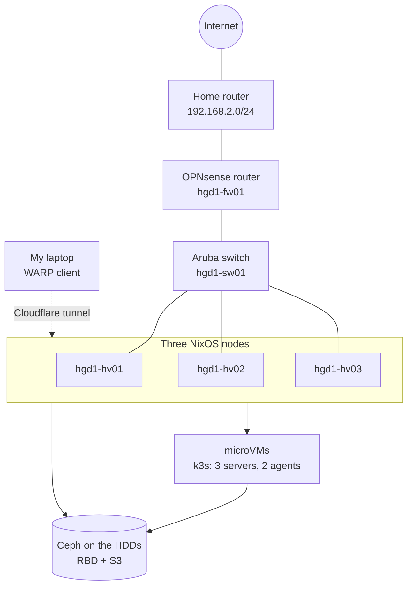

# hgd1 homelab

This is the documentation for my homelab at site **hgd1**: three small x86
machines that run NixOS, Ceph storage and a k3s cluster, plus the router and
switch around them. Everything that can live in code lives in one repository,
[`nix-hgd1-cluster`](https://github.com/jurrebuunk/nix-hgd1-cluster), and is
deployed from my laptop.

I wrote these docs mainly for myself: to remember why things are the way they
are, and to maintain the setup months from now without having to rediscover
it. I also wrote them so that anyone can understand the whole project, build
something on top of it, or take over its maintenance.

## The project at a glance

| Layer | What runs there | Read more |
| --- | --- | --- |
| Network | OPNsense router, Aruba switch, five VLANs in `10.10.0.0/16` | [Network design](network/index.md) |
| Remote access | Cloudflare Tunnel on all three nodes, WARP client on the laptop | [Remote access](network/remote-access.md) |
| Hosts | NixOS 26.05 on `hgd1-hv01..03`, deployed over SSH from this repo | [Hosts](hosts/index.md) |
| Storage | Ceph 20: three monitors, three HDD OSDs, S3 behind `https://s3.lan.buunk.org` | [Ceph](storage/ceph.md), [S3](storage/s3.md) |
| Compute | microVMs (microvm.nix) running a k3s cluster | [VMs](compute/vms.md), [k3s](compute/k3s.md) |
| Workloads | Everything *on* Kubernetes, in a separate repo | [Build on top](build/index.md) |

## Current state

!!! info "Status on 2026-11-23"

    - **Network:** done. Five VLANs, firewall policy, internal DNS
      (`lan.buunk.org`) and remote access through Cloudflare WARP. 83 of 83
      network checks passed, and the router and switch survived reboot tests.
    - **Ceph:** HEALTH_OK. Every pool keeps three copies, one per host, and
      the cluster keeps serving with one host down.
    - **S3:** `https://s3.lan.buunk.org`, a private, highly available endpoint
      with real Let's Encrypt certificates.
    - **k3s:** four of five nodes are Ready. The fifth server
      (`hgd1-k8m02`) waits until I enable VT-x in hv02's BIOS; until then etcd
      has no fault tolerance. See [k3s](compute/k3s.md#finishing-the-cluster).
    - **Next:** platform add-ons (ingress, ceph-csi, Postgres) and the first
      app, in a separate workloads repo. See the [roadmap](understand/roadmap.md).

## Where to start

- **New here?** Read [Architecture](understand/architecture.md) first, then
  [The repository](understand/repository.md). Together they explain every
  moving part and where it is configured.
- **Building an app?** Go to [Build on top](build/index.md): how to get a
  kubeconfig, where your app's state belongs and what the cluster offers.
- **Maintaining the setup?** Start at [Operations](operations/index.md) for
  the daily checks, then [Maintenance](operations/maintenance.md) and
  [Recovery](operations/recovery.md).
- **Looking up an address?** [Addresses and names](reference/addresses.md)
  has every IP, VLAN and DNS name in one place.

## Conventions in these docs

- *I* is me, the owner. *You* is whoever is doing the work, which is usually
  also me.
- Commands run from the repository root on the laptop, unless the prompt shows
  otherwise. Commands that reach the site need the WARP client connected.
- `inventory.nix` is the source of truth for addresses, disks and keys. When
  these docs and the inventory disagree, the inventory wins and the docs need
  fixing.
- Secrets never appear in the repository or in these docs. See
  [Secrets](operations/secrets.md).
