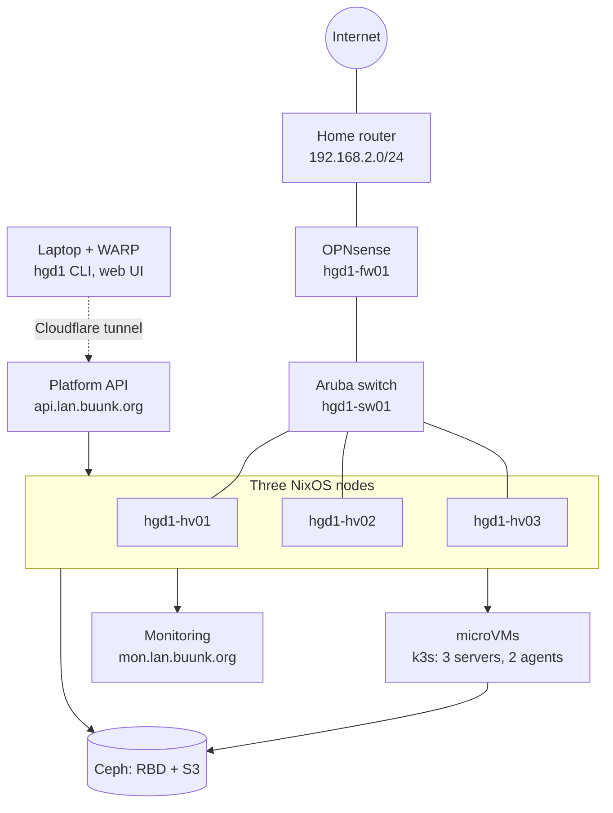

# hgd1 homelab

My homelab at site **hgd1**: three small x86 machines running NixOS, Ceph
storage and a k3s cluster, plus the router and switch around them. Everything
that can be code lives in
[`nix-hgd1-cluster`](https://github.com/jurrebuunk/nix-hgd1-cluster) and is
deployed from my laptop.

I wrote these docs mainly for myself, to maintain the setup months from now
without rediscovering it. They're also written so anyone can understand the
whole project, build on top of it or take over its maintenance.

-   :lucide-rocket:{ .lg .middle } **Get started**

    ---

    Get access, make your first change and find your way around the repo.

    [:octicons-arrow-right-24: Get started](get-started/index.md)

-   :lucide-lightbulb:{ .lg .middle } **Concepts**

    ---

    How the network, hosts, storage and Kubernetes fit together, and why.

    [:octicons-arrow-right-24: Concepts](concepts/index.md)

-   :lucide-wrench:{ .lg .middle } **How-to guides**

    ---

    Short, numbered steps for one task each: deploy, add a VM, add a secret.

    [:octicons-arrow-right-24: How-to](how-to/index.md)

-   :lucide-heart-pulse:{ .lg .middle } **Operate**

    ---

    Health checks, maintenance, troubleshooting and disaster recovery.

    [:octicons-arrow-right-24: Operate](operate/index.md)

-   :lucide-hammer:{ .lg .middle } **Build on top**

    ---

    What the platform offers an app, and where your app's data belongs.

    [:octicons-arrow-right-24: Build an app](how-to/build-an-app.md)

-   :lucide-book-open:{ .lg .middle } **Reference**

    ---

    Every address, port, script, inventory field and term in one place.

    [:octicons-arrow-right-24: Reference](reference/index.md)

## At a glance

| Layer | Status | Read |
| --- | --- | --- |
| Network: OPNsense, Aruba, five VLANs | Done | [Network](concepts/network.md) |
| Remote access through Cloudflare | Done | [Remote access](concepts/remote-access.md) |
| NixOS hosts `hgd1-hv01..03` | Done | [Hosts](concepts/hosts.md) |
| Ceph with three replicas | Done | [Ceph](concepts/ceph.md) |
| S3 at `https://s3.lan.buunk.org` | Done | [S3 endpoint](concepts/s3.md) |
| microVMs | Done | [VMs](concepts/vms.md) |
| k3s cluster: 3 servers, 2 agents | Done | [k3s](concepts/k3s.md) |
| Monitoring and logs | Done | [Monitoring](concepts/monitoring.md) |
| Platform API, CLI and web UI | In development | [Platform API](concepts/api.md) |

## I want to…

| … | Go to |
| --- | --- |
| log in to a host or VM | [Get access](get-started/access.md) |
| change something and deploy it | [Deploy a change](how-to/deploy.md) |
| check or manage the platform from my terminal | [Use the CLI](how-to/use-the-cli.md) |
| see everything in a browser | [Web UI](concepts/web-ui.md) |
| run an app on the cluster | [Build an app](how-to/build-an-app.md) |
| check that everything is healthy | [Health check](operate/index.md) |
| reboot or service a host | [Host maintenance](operate/host-maintenance.md) |
| fix something that's broken | [Troubleshooting](operate/troubleshooting.md) |
| look up an IP address | [Addresses](reference/addresses.md) |
| change the router or switch | [`hgd1-network`](https://github.com/jurrebuunk/hgd1-network) (Ansible) |
| work on the API, CLI or web UI | [`clusterd`](https://github.com/jurrebuunk/clusterd), [`lab-console`](https://github.com/jurrebuunk/lab-console) |
| see which repo owns what | [Repositories](reference/repositories.md) |
| find metrics or logs | [Monitoring](concepts/monitoring.md#operating) |
| find a credential | [Credentials](reference/credentials.md) |

## Conventions

- *I* is me, the owner. *You* is whoever does the work, usually also me.
- Commands run from the repository root on the laptop, with WARP connected,
  unless they say otherwise.
- `inventory.nix` is the source of truth. If the docs disagree with it, the
  docs are wrong.
- Secrets never appear in the repo or in these docs.
- Hover over terms like VIP or OSD for a short explanation, or see the
  [glossary](reference/glossary.md).
