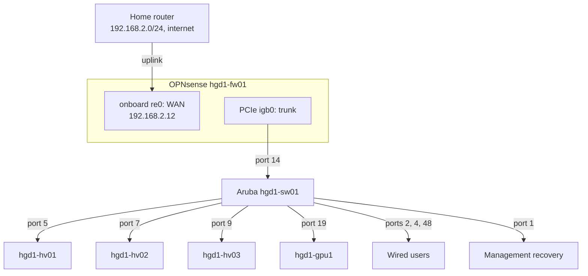

# Network design

The site network separates management, hosts, storage, Kubernetes and users
into VLANs behind one OPNsense router. The router and switch are not managed
by Nix; their configuration is described here and backed up as files outside
Git (they contain secrets).

## Physical layout



The internet uplink goes into the router's **onboard NIC**, never into the
switch. WAN traffic therefore never touches the switch, and the home network
can't leak into the internal VLANs. Two spare PCIe ports are cabled to the
switch (ports 16 and 18) but disabled, ready to become an LACP bundle later.

## VLANs and addressing

The site uses `10.10.0.0/16`, and the third octet is always the VLAN ID.
`10.42.0.0/16` and `10.43.0.0/16` are kept free for k3s pods and services.

| VLAN | Name | Subnet | Gateway | DHCP | What lives there |
| --- | --- | --- | --- | --- | --- |
| 10 | mgmt | `10.10.10.0/24` | `.1` | `.100–.199` | Router, switch, later Wi-Fi AP |
| 20 | infra | `10.10.20.0/24` | `.1` | no | Hypervisors, `hgd1-gpu1` |
| 30 | storage | `10.10.30.0/24` | none | no | Ceph between hosts and VMs; **not routed** |
| 40 | k8s | `10.10.40.0/24` | `.1` | no | k3s VMs, API VIP `.10`, load balancers `.200–.249` |
| 100 | users | `10.10.100.0/24` | `.1` | `.100–.249` | Wired users, the Windows gaming VM |

The storage VLAN never reaches the router. Only the hosts and VMs that have a
leg in it can talk Ceph, which keeps the storage traffic off the router and
out of reach of everything else. Every individual address is listed in
[Addresses and names](../reference/addresses.md).

## How a host is wired

Each hypervisor has one cable to a switch port that carries VLAN 20 untagged
and VLANs 30 and 40 tagged. NixOS turns that into:

```text
enp2s0         10.10.20.1x/24   host management, default route
enp2s0.30 ─► br-stor  10.10.30.1x/24   Ceph and S3, VM storage NICs attach here
enp2s0.40 ─► br-k8s   (no address)     VM k8s NICs attach here
```

`br-k8s` deliberately has no host address: the host is not reachable from the
k8s VLAN, and its firewall drops anything that would route between the bridges
and the rest of the host. See `modules/network.nix` and
`modules/microvm/host/networking.nix`.

## Switch ports

| Role | Ports | Untagged | Tagged |
| --- | --- | --- | --- |
| Router trunk (PCIe port 1, `igb0`) | 14 | 10 | 20, 40, 100 |
| Hypervisors | 5, 7, 9 | 20 | 30, 40 |
| `hgd1-gpu1` and its gaming VM | 19 | 20 | 100 |
| Wired users | 2, 4, 48 | 100 | – |
| Management recovery | 1 | 10 | – |
| Spare router links | 16, 18 | 999, disabled | – |
| Everything else | – | 999, disabled | – |

Port order says nothing about which host is plugged in. Before changing a
hypervisor port, confirm the host by its MAC address from the inventory.

## Firewall policy

Between VLANs everything is denied unless listed here.

| From | Allowed | Blocked |
| --- | --- | --- |
| mgmt (10) | Everything internal, internet | – |
| infra (20) | Internet (Nix caches), DNS and NTP on OPNsense; the three hypervisors may also reach mgmt, k8s and users (remote access, below) | Everything else internal |
| k8s (40) | Internet (image registries), DNS and NTP on OPNsense | mgmt, infra, users |
| users (100) | Internet; HTTP and HTTPS to k8s load balancer IPs | mgmt, infra, k8s nodes |
| WAN (home) | Only the game streaming forwards below | Everything else |

The "tunnel hosts" exception is implemented with two OPNsense aliases:
`HGD1_TUNNEL_HOSTS` (`10.10.20.11–13`) may reach `HGD1_TUNNEL_DESTS`
(`10.10.10.0/24`, `10.10.40.0/24`, `10.10.100.0/24`). That is what lets remote
access through `cloudflared` reach the whole site.

## DNS and time

OPNsense runs Unbound with DNSSEC for the internal zone `lan.buunk.org`, and
serves NTP. Every fixed address has a host override, for example
`hgd1-hv01.lan.buunk.org`, `s3.lan.buunk.org` (S3 VIP) and
`k8s.lan.buunk.org` (Kubernetes API VIP). DHCP clients on mgmt and users are
registered automatically. Hosts also keep each other's names in `/etc/hosts`,
so they can resolve each other even when the router is down.

Ceph needs closely synchronised clocks, so hosts run chrony and explicitly
prefer OPNsense, with the public pool only as a fallback.

## Game streaming from home

My gaming VM on `hgd1-gpu1` runs Sunshine. Moonlight clients on the home
network reach it through the router's WAN address; this is the only permanent
inbound exception.

- Source: the whole home network `192.168.2.0/24`.
- Destination: the OPNsense WAN address `192.168.2.12`, forwarded to
  `10.10.100.50` on the same ports.
- TCP `47984, 47989, 48010`; UDP `47998–48000, 48002, 48010`.
- Not forwarded: Sunshine's admin UI (47990), RDP and discovery.

In Moonlight at home, add `192.168.2.12` by hand. On the users VLAN, use
`10.10.100.50` directly.

!!! warning "Keep "Block private networks" off on WAN"

    The WAN *is* a private network (my home LAN), so that checkbox would block
    the streaming forwards. Default deny plus the narrow forwards already
    protect the site.

## Router and switch management

- **OPNsense:** `ssh root@10.10.10.1` (key only), web UI at
  `https://10.10.10.1`. Version 26.7.9_3 with the `os-isc-dhcp` and
  `os-firewall-legacy` plugins.
- **Switch:** `ssh manager@10.10.10.2` with a dedicated key. Its old SSH
  implementation needs legacy algorithms; I keep a matching `ssh_config` in
  `~/.local/state/nix-cluster/network-rollout/`.
- **Backups:** before every larger change I export the OPNsense
  `config.xml` and the switch's running config to that same directory, mode
  0600. They contain password hashes and keys, so they never go into Git.

Both are reachable only from the site or through WARP. Without WARP, switch
port 1 (mgmt) or the OPNsense console always work.

## Future ideas

- A Wi-Fi access point managed on VLAN 10, with SSIDs on users (100), guest
  (110) and IoT (120).
- A DMZ (50) if something ever has to be exposed outside Kubernetes ingress.
- LACP over PCIe ports 1–3; jumbo frames on the storage VLAN.
- Cloudflare Mesh, only if the site ever needs to connect back to my laptop.
