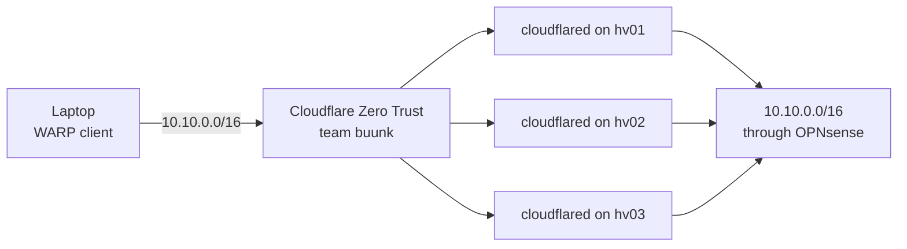

# Remote access

I reach the whole site (`10.10.0.0/16`) from anywhere as if I were plugged into
it: SSH, the router and switch, the Kubernetes API and internal DNS names.
There are no inbound ports for this. Cloudflare carries the traffic, and nothing
inside the cluster depends on it.

## How it works



- **One tunnel, three connectors.** The tunnel `hgd1-admin` runs on all three
  hypervisors (`modules/remote-access.nix`). Each connector dials out to
  Cloudflare; any one of them keeps access up.
- **The tunnel announces `10.10.0.0/16`.** Cloudflare sends my traffic for
  that range to whichever connector is healthy, and the hypervisor forwards it
  through OPNsense like any other host traffic.
- **The laptop runs the WARP client** (Cloudflare One), enrolled in my Zero
  Trust organisation. Only my email address can enrol.
- **Internal servers see the hypervisor as the source.** Who may connect is
  decided in Cloudflare, not on the servers.

## Daily use

```sh
warp-cli connect          # when away, or when managing the site from home
ssh jurre@10.10.20.11     # works from anywhere now
warp-cli disconnect       # normal internet use at home
```

Split tunnelling is in **Include** mode: only `10.10.0.0/16` and the
Cloudflare team domain go through WARP, everything else uses the normal
internet connection. On the users VLAN at home, disconnect WARP; otherwise
traffic to the site goes out to Cloudflare and back in instead of straight
through OPNsense.

Internal names resolve while connected, because Local Domain Fallback sends
`lan.buunk.org` queries to OPNsense (`10.10.20.1`). There is no mDNS or
`.local` discovery over the tunnel.

## What protects it

| Layer | Rule |
| --- | --- |
| Enrolment | Access policy "Allow Jurre": only my email can register a device (one-time PIN login) |
| Gateway network rules | 1. Block `10.10.30.0/24` (storage) for everyone. 2. Allow `10.10.0.0/16` for my email. 3. Block `10.10.0.0/16` for everyone else |
| OPNsense | Only `10.10.20.11–13` may forward into mgmt, k8s and users (aliases `HGD1_TUNNEL_HOSTS` → `HGD1_TUNNEL_DESTS`) |
| Storage | Not routed at all, and blocked in Gateway as a second line |

Gateway's proxy settings have TCP, UDP and ICMP enabled. ICMP is only there so
`ping` works; Gateway can't filter it, so storage addresses still answer pings
while TCP and UDP to storage stay blocked.

## Where things are configured

| Piece | Where |
| --- | --- |
| Tunnel ID and routes | `inventory.nix` → `remoteAccess` |
| `cloudflared` service | `modules/remote-access.nix` |
| Tunnel credentials | `secrets/cloudflared-tunnel.age` (agenix) |
| Organisation, enrolment, device profile, Gateway rules | Cloudflare Zero Trust dashboard (team `buunk`) |
| Laptop client | My NixOS laptop config: `services.cloudflare-warp.enable = true` |

## Setting it up from scratch

Do this only after the hosts are on their static addresses.

1. **Zero Trust organisation.** Create it on the Free plan, keep the One-time
   PIN login, and add a device enrolment rule that allows only your email.
2. **Tunnel.** From the dev shell:

    ```sh
    cloudflared tunnel login                       # browser, pick the zone
    cloudflared tunnel create hgd1-admin           # prints the tunnel UUID
    cloudflared tunnel route ip add 10.10.0.0/16 hgd1-admin
    ```

    Put the UUID in `inventory.nix` → `remoteAccess.tunnelId`.

3. **Credentials.** `create` wrote `~/.cloudflared/<UUID>.json`. Encrypt it as
   `secrets/cloudflared-tunnel.age` (see [Secrets](../operations/secrets.md)),
   keep a copy in your password manager, then delete the JSON file.
4. **Deploy** one host at a time and check
   `systemctl status 'cloudflared-tunnel-*'`. The dashboard shows three
   connectors.
5. **Device profile.** Split Tunnels in Include mode with `10.10.0.0/16` and
   the team domain; Local Domain Fallback for `lan.buunk.org` to `10.10.20.1`.
6. **Gateway.** Enable the TCP, UDP and ICMP proxy, and add the three network
   rules from the table above.
7. **OPNsense.** Add the two aliases and the INFRA rule above the INFRA deny
   rule.
8. **Laptop.** `warp-cli registration new buunk`, then `warp-cli connect`.

**Verify** from outside the home network (a phone hotspot is enough):
`ssh jurre@10.10.20.11 hostname`, `getent hosts hgd1-hv02.lan.buunk.org`
and `curl -k https://10.10.10.1`. Then stop `cloudflared` on one host and
check that all of it still works.

## Limits

- The site cannot open connections back to the laptop. That would need
  Cloudflare Mesh; I'll only add it if I ever need it.
- With WARP down and no site cable, the only ways in are switch port 1 (mgmt)
  and the OPNsense console. See [Recovery](../operations/recovery.md).
- The Free plan covers this easily (one user, three connectors).
