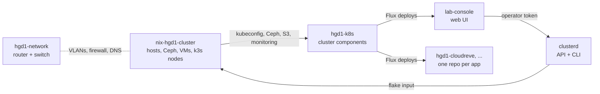

# Repositories

The lab is split over five core repos plus one repo per app. Each has one job and its own way of
delivering changes, and every repo has a `README.md` and a `PLAN.md` with its
details.

## Docs

Three doc sites, each covering only what its repo owns, with the same look
in their own colour. A link or card in another site's colour leads there.

| Site | Repo | Covers | Published |
| --- | --- | --- | --- |
| **Cluster** (this one) | `nix-hgd1-cluster` | Hosts, Ceph, S3, VMs, k3s nodes, monitoring, remote access, `clusterd`/`labctl` | [GitHub Pages](https://jurrebuunk.github.io/nix-hgd1-cluster/) |
| **Kubernetes** | `hgd1-k8s` | Flux, public access, Postgres, Keycloak, pod monitoring, building an app, the web UI | [GitHub Pages](https://jurrebuunk.github.io/hgd1-k8s/) |
| **Network** | `hgd1-network` | Router, switch, VLANs, firewall policy, rebuilding the network | Not yet (private repo); [read on GitHub](https://github.com/jurrebuunk/hgd1-network/blob/main/docs/index.md) |

`docs/stylesheets/flatwork.css` is identical in the three repos; each
site's colour is in its own `docs/stylesheets/site.css`.

## Repos

| Repo | Owns | Delivered by | Visibility |
| --- | --- | --- | --- |
| [`nix-hgd1-cluster`](https://github.com/jurrebuunk/nix-hgd1-cluster) | Hosts, Ceph, S3 endpoint, VMs, the k3s nodes, monitoring, remote access, the cluster docs | `deploy`, host by host | Public |
| [`clusterd`](https://github.com/jurrebuunk/clusterd) | The [Platform API](../concepts/api.md) server and the `labctl` CLI, plus their NixOS module | Flake input of `nix-hgd1-cluster` | Public |
| [`lab-console`](https://github.com/jurrebuunk/lab-console) | The [web UI](https://jurrebuunk.github.io/hgd1-k8s/concepts/web-ui/) at `lab.buunk.org`: frontend and its thin API proxy | CI image to GHCR, deployed by Flux | Public |
| [`hgd1-k8s`](https://github.com/jurrebuunk/hgd1-k8s) | Base components on the k3s cluster: Flux, sops, metrics-server, local-path, the public Cloudflare Tunnel, CloudNativePG, k3s monitoring, Keycloak; later local ingress | Flux (pull-based GitOps) | Public |
| [`hgd1-cloudreve`](https://github.com/jurrebuunk/hgd1-cloudreve) | Cloudreve at `cloudreve.buunk.org`: its manifests, database, bucket gateway and secrets | Flux, through a pointer in `hgd1-k8s/apps/` | Public |
| `hgd1-network` | Ansible for the router `hgd1-fw01` and the switch `hgd1-sw01` | `ansible-playbook` from the laptop over WARP | Private |

## How they fit

## Rules between repos

- **Facts flow from the inventory.** Addresses and names are defined in
  `inventory.nix`; `hgd1-network` keeps its variables in step with it.
- **No credentials for the cluster in GitHub.** `hgd1-k8s` is pulled by Flux
  inside the cluster; CI only builds images.
- **Secrets stay encrypted:** agenix here, sops with age in `hgd1-k8s` and
  `hgd1-network`. See [Credentials](credentials.md).
- **Nix or Flux.** What has to exist before Kubernetes works, or keep
  working when it's broken, comes from this repo (hosts, Ceph, S3, k3s with
  CoreDNS, `clusterd`); what runs as pods comes from `hgd1-k8s` through Flux.
- **Inside `hgd1-k8s`, layers by dependency:** `infrastructure` (controllers
  and operators), `config`, `platform` (shared services such as Keycloak),
  `apps`. Flux applies each after the one before.
- **Every app has its own repo.** Off-the-shelf (`hgd1-cloudreve`: only
  manifests) or your own (`lab-console`: code, CI and manifests), Flux
  deploys its `deploy/` folder. `hgd1-k8s/apps/` holds only the pointers;
  `hgd1-k8s` itself has the platform (operators, Keycloak, the tunnel and
  its routes), never an app.
- **Package and module in the tool's repo, configuration here.** `clusterd`
  exports `packages.clusterd`, `packages.labctl` and `nixosModules.clusterd`;
  this repo sets the options.

## Related

- [Tour of the repo](../get-started/repository.md) · [Roadmap](roadmap.md)
