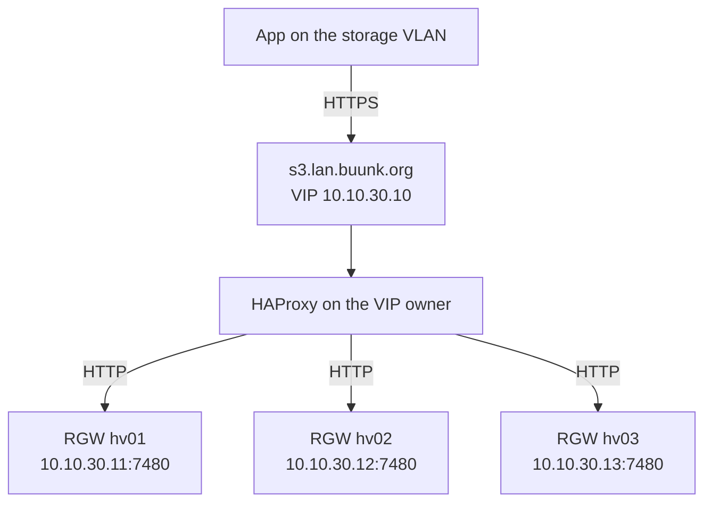

# S3 endpoint

Applications use one stable address for object storage:
**`https://s3.lan.buunk.org`**. It has a real, publicly trusted certificate and
keeps working when a host goes down. It doesn't depend on Kubernetes.

## How it works



- **One floating IP.** Keepalived on the three hosts gives `10.10.30.10` to
  exactly one of them.
- **HAProxy terminates TLS** and sends each request to any healthy gateway.
  All gateways share one object store, so it doesn't matter which one answers.
- **No rewriting.** Host, path and query pass through unchanged, so S3
  signatures and presigned URLs stay valid.
- **Storage VLAN only.** There is no public exposure, and the router has no
  route into storage.

Clients use region `us-east-1`, SigV4 and **path-style** addressing
(`https://s3.lan.buunk.org/<bucket>/<key>`). Wildcard bucket hostnames are not
configured.

## Failover

The VIP belongs to a host whose **proxy works**, not to a host where Ceph is
healthy. Keepalived checks a loopback TLS listener (`127.0.0.1:9443`) with full
certificate validation, so:

- a host whose local RGW or Ceph is down keeps the VIP; its proxy just uses
  the other gateways;
- a host whose HAProxy stops, or that only has a self-signed or staging
  certificate, loses the VIP;
- a host that comes back doesn't take the VIP back (no preemption).

VRRP is unicast between the three storage addresses, accepted only from those
peers with TTL 255. A switchover takes about five seconds. Open TCP
connections don't survive it, so clients must retry. Every S3 SDK does.
VRRP is not a quorum protocol: this protects against host and service
failures, not against a split network.

## Certificates

Each host gets its own Let's Encrypt certificate through the **DNS-01**
challenge at Cloudflare, so no public record or open port is needed.

- State lives in `/var/lib/acme/s3.lan.buunk.org` on each host.
- The Cloudflare API token is in `secrets/s3-acme-cloudflare.age` and reaches
  the renewal service as a systemd credential.
- Renewal runs daily with jitter on every host and reloads HAProxy
  gracefully.
- Encrypted backups of the certificate and account state are under
  `~/.local/state/nix-hgd1-cluster/s3-ha/` on my laptop.

!!! warning "Token scope"

    The current token is the broad one `cloudflared` created during login.
    Replace it with a token limited to DNS edit on `buunk.org`, and update the
    secret before revoking the old token.

## Where it is configured

| File | Owns |
| --- | --- |
| `inventory.nix` → `ceph.s3` | Hostname, VIP, VRRP router ID, ACME email and server |
| `modules/s3-ha/default.nix` | Imports and inventory checks |
| `modules/s3-ha/tls.nix` | ACME, DNS-01 credentials, renewal |
| `modules/s3-ha/proxy.nix` | HAProxy listeners and backends |
| `modules/s3-ha/failover.nix` | Keepalived and the health check |
| `modules/s3-ha/firewall.nix` | HTTPS and VRRP on `br-stor` only |
| `modules/ceph.nix` | Makes Ceph advertise the physical IP, never the VIP |

The DNS record `s3.lan.buunk.org → 10.10.30.10` (TTL 60) is a host override
on OPNsense.

## Users and buckets

S3 credentials are separate from Ceph keys and SSH logins. Give each
application its own user; don't share my personal `jurre` user (its keys are
root-only on hv01 in `/root/jurre-s3-credentials.json`).

Create a user on any host, writing the keys straight to a root-only file:

```sh
sudo sh -c 'umask 077; radosgw-admin user create --uid=my-app \
  --display-name="My application" > /root/my-app-s3-credentials.json'
```

Then, from a client on the storage VLAN:

```sh
aws configure --profile my-app                       # keys from that file, region us-east-1
aws configure set s3.addressing_style path --profile my-app
aws --profile my-app --endpoint-url https://s3.lan.buunk.org s3 mb s3://my-bucket
aws --profile my-app --endpoint-url https://s3.lan.buunk.org s3 ls
```

Bucket names are global within this object store.

## From the laptop

Cloudflare Gateway blocks storage on purpose, so the laptop needs an SSH
forward through a host. This keeps the hostname and certificate check intact:

```sh
ssh -N -L 127.0.0.1:17443:10.10.30.10:443 jurre@10.10.20.11
curl --connect-to s3.lan.buunk.org:443:127.0.0.1:17443 https://s3.lan.buunk.org/
```

Don't use `https://127.0.0.1` with certificate checks switched off. For quick
debugging without TLS, a gateway can be forwarded directly:
`ssh -N -L 17480:10.10.30.11:7480 jurre@10.10.20.11`.

## Checking it

```sh
ssh jurre@10.10.20.11 'systemctl status haproxy keepalived --no-pager'
for h in 11 12 13; do ssh jurre@10.10.20.$h 'hostname; ip -br addr show br-stor'; done   # exactly one has .10
ssh jurre@10.10.20.11 'systemctl list-timers "acme-*" --no-pager'
```

HAProxy logs leave out object paths and presigned query strings on purpose.

## What was tested

- SigV4 PUT and GET, odd and Unicode object names, presigned URLs and 12 MiB
  multipart uploads, all byte-for-byte checked through the VIP.
- A local Ceph/RGW outage left the VIP in place while S3 kept working through
  the other gateways.
- Stopping the active HAProxy or Keepalived moved the VIP; a throttled upload
  that was cut off retried and completed identically.
- Rebooting the VIP owner moved the VIP, and Ceph returned to HEALTH_OK.
- HAProxy and Keepalived together use about 20–31 MiB of memory per host.
