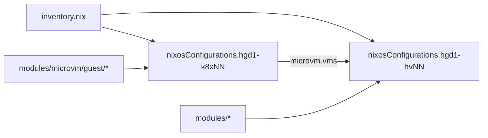

# The repository

The repo is a Nix flake. It describes every host and VM as a
`nixosConfiguration`, and it holds the scripts and docs to run them. This page
walks through it in the order you will need it.

## Layout

| Path | What it holds |
| --- | --- |
| [`flake.nix`](https://github.com/jurrebuunk/nix-hgd1-cluster/blob/main/flake.nix) | Inputs (nixpkgs 26.05, microvm.nix, agenix), one `nixosConfiguration` per host and per VM, and the dev shell |
| [`inventory.nix`](https://github.com/jurrebuunk/nix-hgd1-cluster/blob/main/inventory.nix) | All cluster facts: VLANs, IPs, MACs, disks, host keys, Ceph ids, VMs, k3s and remote access |
| `hosts/common.nix` | Settings shared by every host: Nix, SSH, users, time, journald |
| `hosts/<host>/` | Bootloader, hostname and the generated hardware configuration |
| `modules/network.nix` | Host networking: VLAN 20 address, `br-stor` and `br-k8s` |
| `modules/ceph.nix` | Ceph mon, mgr, OSD and RGW |
| `modules/s3-ha/` | The S3 endpoint: TLS, HAProxy, Keepalived and firewall |
| `modules/remote-access.nix` | Cloudflare Tunnel (`cloudflared`) |
| `modules/rollout-safety.nix` | An opt-in, self-reverting guard for risky network changes |
| `modules/microvm/host/` | Running VMs on a host: lifecycle, inventory checks, TAP networking, k3s token sharing |
| `modules/microvm/guest/` | Inside a VM: resources, disks, networking, SSH, and `k3s/` |
| `lib/` | Pure helpers shared by host and guest modules (`vm-network.nix`, `k3s.nix`) |
| `scripts/` | `deploy.sh`, `vm.sh`, `k3s-roll.sh`, `kubeconfig.sh`, `ceph-bootstrap.sh` |
| `secrets/` | agenix recipients (`secrets.nix`) and encrypted `*.age` files |
| `docs/`, `zensical.toml` | This documentation site |

## The inventory is the source of truth

`inventory.nix` is a plain attribute set with nothing secret in it. Modules
never hard-code an address; they read it from the inventory. To understand
what a host or VM is, read its entry there first.

```nix
hosts.hgd1-hv01 = {
  ip = { infra = "10.10.20.11"; storage = "10.10.30.11"; };
  interface = "enp2s0";
  kvmAvailable = true;                 # hv02 is false until VT-x is enabled
  hostKey = "ssh-ed25519 AAAA...";     # pinned; agenix encrypts to it
  hdd = "/dev/disk/by-id/ata-HGST_...";
  osd = { id = "0"; uuid = "..."; };
};

vms.hgd1-k8m01 = {
  host = "hgd1-hv01"; enabled = true; id = 11; role = "server";
  hostKey = "ssh-ed25519 AAAA...";
  vcpu = 2; memMB = 4096; diskGB = 60;
  ip = { k8s = "10.10.40.11"; storage = "10.10.30.21"; };
};
```

The inventory also has `vlans`, `dns`, `ntp`, `ceph` (FSID and the S3
endpoint), `k3s` (API name, VIP, bootstrap server), `remoteAccess` (tunnel ID)
and `adminKeys` (my laptop key). The scripts read the same file with
`nix eval`, so a script and a module can never disagree about an address.

Mistakes are caught early. `modules/microvm/host/validation.nix` asserts, for
example, that VM ids and IPs are unique, that VM IPs sit in the right VLANs,
that no host gets more than 11 GiB of VM memory, and that the k3s VIP is free.
`nix flake check` fails on any of those before anything is deployed.

## How the flake is built



- Each **host** configuration imports all modules in `modules/` plus its own
  `hosts/<host>/`. Features are switched on or off by the inventory, not by
  choosing imports per host.
- Each **VM** is its own configuration built from `modules/microvm/guest/`,
  with `vm` and `vmName` passed in as `specialArgs`. The host that owns the VM
  embeds that configuration and installs its runner.
- Both appear as flake outputs, so `nix build .#nixosConfigurations.hgd1-k8m01.config.system.build.toplevel`
  works for a VM too.

## Module conventions

These keep the code readable. Follow them when you add something.

- Every module starts with a one-line comment that says what it is for, and
  has a one-line argument header such as `{ config, lib, inventory, ... }:`.
- A feature with several parts gets a directory with an explicit
  `default.nix` that imports its children (`modules/s3-ha/`,
  `modules/microvm/guest/k3s/`). A focused feature stays a single file.
- Each child keeps its own enable guard (`lib.mkIf`), because `mkIf` cannot
  skip an import.
- Keep a service's dependencies, firewall rules and small scripts next to
  that service. Don't create tiny wrapper files just to save lines.
- Things that are not modules (pure functions) go in `lib/` and are imported
  with `import ../lib/<file>.nix { ... }`.
- Comments explain *why*, not what.

!!! tip "Checking a refactor"

    For a change that should not alter behaviour, record every
    `nixosConfigurations.<name>.config.system.build.toplevel.outPath` before
    and after. Identical paths prove nothing changed and nothing needs to be
    deployed.

## The dev shell

`nix develop` gives you the tools these docs use: `nixos-rebuild`, `agenix`,
`cloudflared`, `kubectl`, `jq`, `nmap`, `shellcheck` and `zensical`. It also
sets `KUBECONFIG` to `~/.kube/hgd1.yaml`.

## Working on these docs

The docs are Markdown in `docs/`, built with [Zensical](https://zensical.org/).

```sh
nix develop
zensical serve          # http://localhost:8000, rebuilds on save
```

Every push to `main` builds the site and publishes it to GitHub Pages
(`.github/workflows/docs.yml`). Link to code with full GitHub URLs, because
relative links to files outside `docs/` don't exist on the site.
